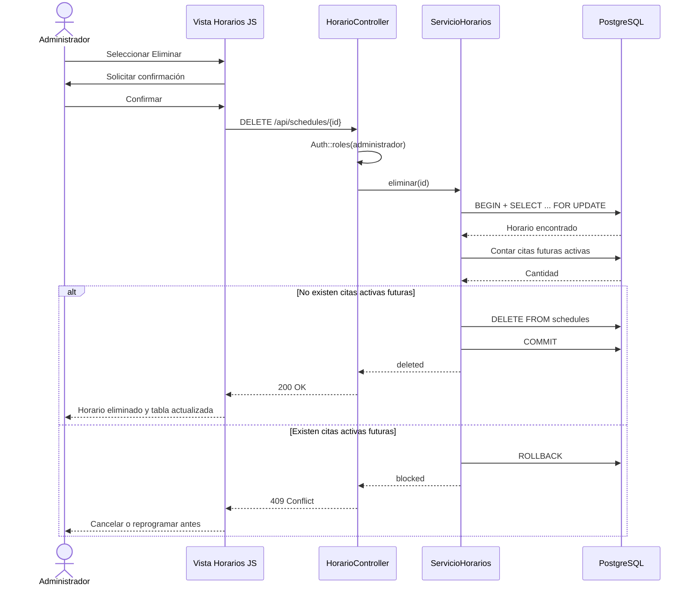

# Actualización V4 · URL por módulo y eliminación de horarios

## CU05 Gestionar horarios médicos (ampliación)

**Actor principal:** Administrador.  
**Objetivo:** registrar y retirar las franjas de atención semanales sin alterar las citas ya comprometidas.  
**Precondiciones:** administrador autenticado; médico registrado.  
**Postcondición (eliminar):** el horario deja de ofrecer nuevas citas y las consultas históricas se conservan.

### Flujo normal: eliminar

1. El administrador inicia sesión y entra en `/administrador/horarios`.
2. El cliente carga `GET /api/schedules` y muestra los horarios con sus citas futuras activas.
3. Selecciona **Eliminar** en un horario sin citas futuras activas.
4. Confirma la operación.
5. JavaScript invoca `DELETE /api/schedules/{id}` con cookie de sesión y token CSRF.
6. `HorarioController::eliminar` comprueba el rol administrador y delega en `ServicioHorarios::eliminar`.
7. El servicio inicia una transacción PostgreSQL, bloquea la fila y comprueba las citas futuras con estado `pendiente` o `confirmada`.
8. Si está disponible, elimina exclusivamente la fila de `schedules`, confirma la transacción y devuelve `200`.
9. La interfaz actualiza la lista y muestra un mensaje de confirmación.

### Excepciones

- **403:** una persona sin rol administrador intenta eliminar una franja.
- **419:** token CSRF ausente o inválido.
- **404:** el horario ya no existe.
- **409:** el horario tiene una o varias citas futuras pendientes o confirmadas. Se deberá cancelar o reprogramar primero.
- **500:** error inesperado en la base de datos; transacción revertida.

## Secuencia de diseño (CU05)

## Rutas de interfaz (pueden abrirse individualmente)

| Rol | Dirección | Vista |
| --- | --- | --- |
| Administrador | `/administrador` | Resumen |
| Administrador | `/administrador/horarios` | Horarios médicos |
| Administrador | `/administrador/medicos` | Médicos |
| Administrador | `/administrador/pacientes` | Pacientes |
| Administrador | `/administrador/citas` | Agenda |
| Administrador | `/administrador/especialidades` | Especialidades |
| Administrador | `/administrador/facturacion` | Facturas |
| Administrador | `/administrador/usuarios` | Usuarios |
| Administrador | `/administrador/notificaciones` | Avisos |
| Paciente | `/paciente/citas` | Mis citas |
| Médico | `/medico/historias-clinicas` | Consultas |
| Recepcionista | `/recepcionista/citas` | Agenda |

Las URL son rutas de cliente con HTML y JavaScript, manejadas con `history.pushState`, `popstate` y un `index.php` que sirve la vista principal. Su URL es real para el navegador, pero compartir plantilla **no** significa compartir privilegios: el servidor verifica permisos en las APIs PHP. El módulo administrativo de horarios está aislado en `HorarioController` y `ServicioHorarios`.

## Estructura de clases SOLID

- **`HorarioController`**: validación HTTP, respuesta, rol de usuario.
- **`ServicioHorarios`**: decisión de eliminación y transacción, incluyendo protección de citas futuras.
- **`PostgresCitaRepository`**: verifica horarios compatibles y solicita bloqueo compartido dentro de la transacción de agendamiento.
- **`GestorCitas`**: coordina el agendamiento sin conocer detalles de PostgreSQL.
- **`NotificadorInterface` y `FacturadorInterface`**: siguen siendo puntos de extensión independientes.

## Pruebas

`php tests/run.php` · `php tests/horarios.php` · `node tests/rutas_ui.mjs`

Las pruebas PHP de horarios usan dobles de PDO para probar la lógica sin necesidad de conectar a PostgreSQL. **Pendiente de ejecutar la prueba integrada de DELETE dentro de Docker con la BD real.**
