# Diseño de SaludCita — Diagramas de secuencia del Ciclo 1 y Ciclo 2

Estos diagramas complementan los 16 diagramas de comunicación existentes en `docs/diagramas/`.
Representan **la arquitectura actual del proyecto**, no reemplazan los diagramas conceptuales de análisis.
Los mensajes son resumidos: se omiten validaciones secundarias y detalles SQL.

## CU01 — Iniciar sesión

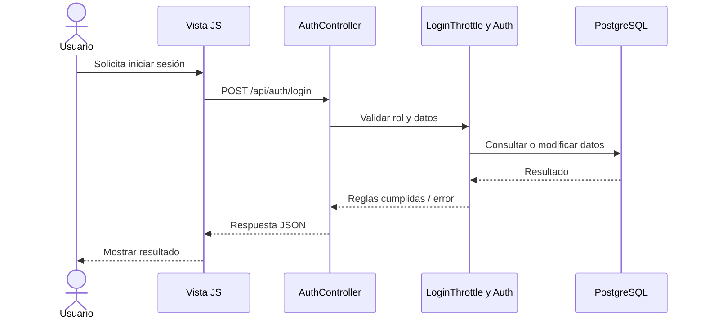

**Regla principal:** Verificar contraseña, rol y límite de intentos.

## CU02 — Registrar paciente

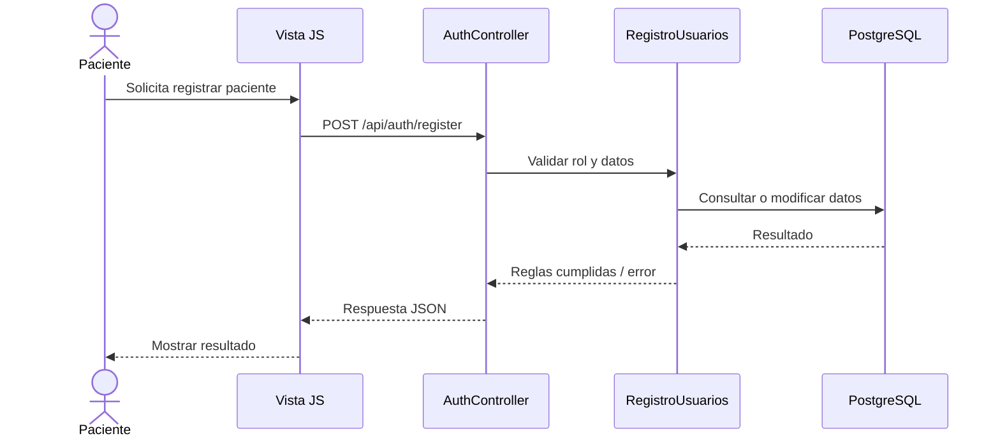

**Regla principal:** Crear usuario y perfil paciente en transacción.

## CU03 — Administrar usuarios

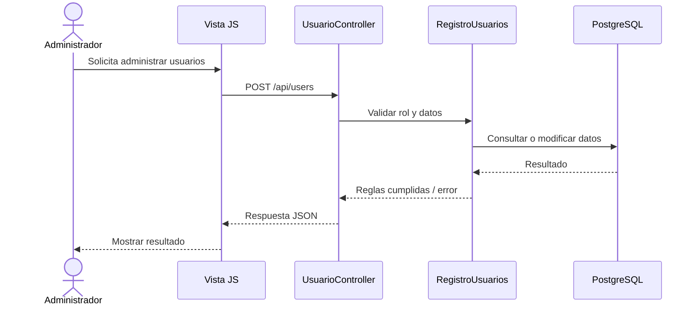

**Regla principal:** Alta de administrador o recepción; baja lógica en DELETE /api/users/{id}.

## CU04 — Gestionar médicos y especialidades

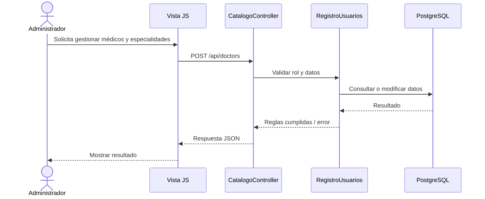

**Regla principal:** Crear usuario médico y asociarlo a su especialidad.

## CU05 — Configurar y eliminar horarios

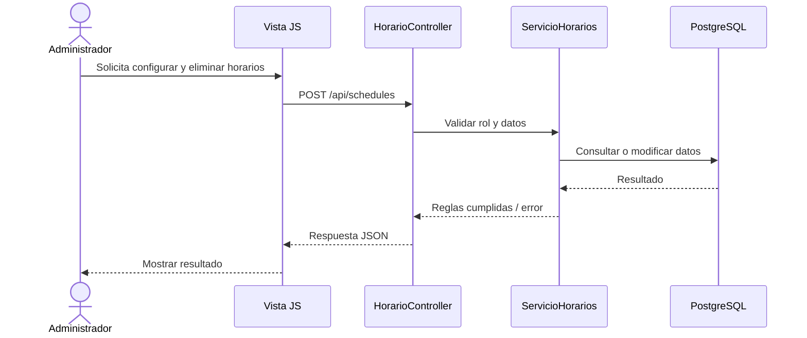

**Regla principal:** Validar intervalo; DELETE bloquea si existen citas futuras.

## CU06 — Agendar una cita

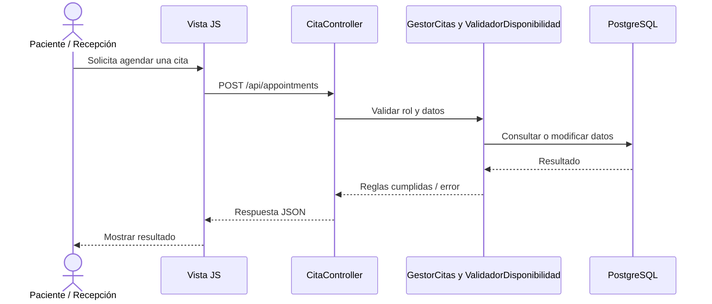

**Regla principal:** Evitar duplicados por médico/paciente; enviar aviso.

## CU07 — Consultar agenda

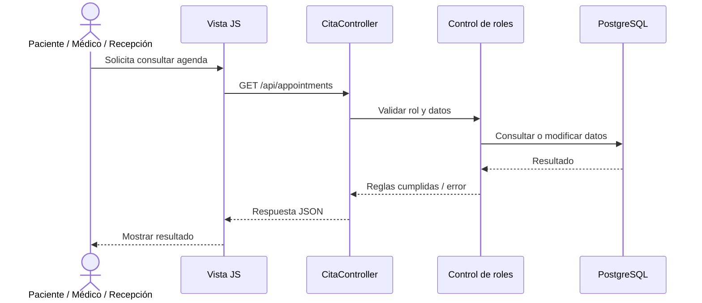

**Regla principal:** Filtrar citas propias para paciente o médico.

## CU08 — Gestionar estado de cita

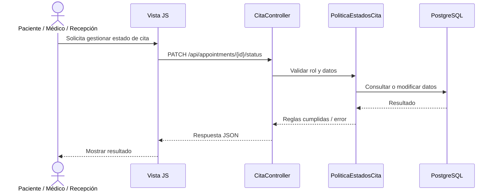

**Regla principal:** Validar transición permitida y avisar al paciente.

## CU09 — Registrar consulta médica

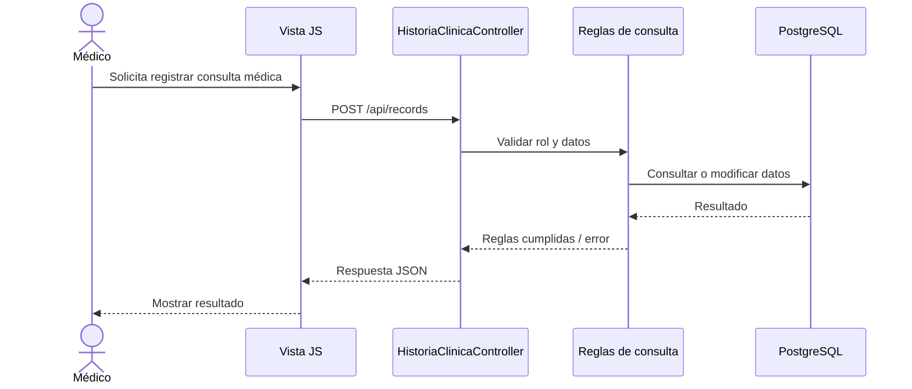

**Regla principal:** Verificar cita propia pasada y guardar historia clínica.

## CU10 — Consultar historia clínica

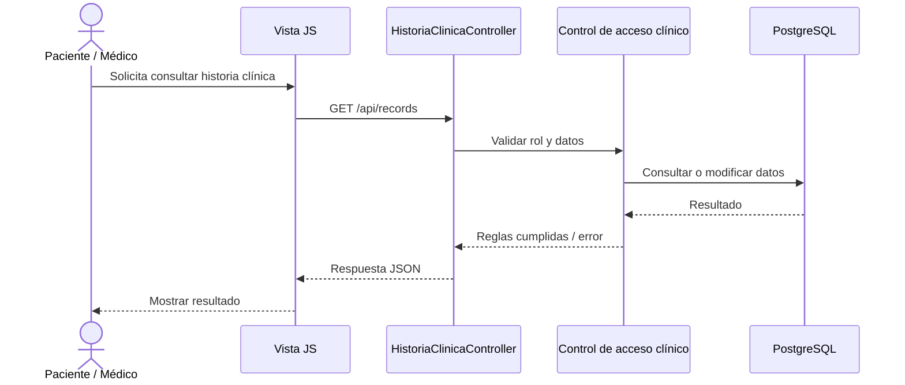

**Regla principal:** Consultar solo registros del paciente o médico autorizados.

## CU11 — Emitir factura

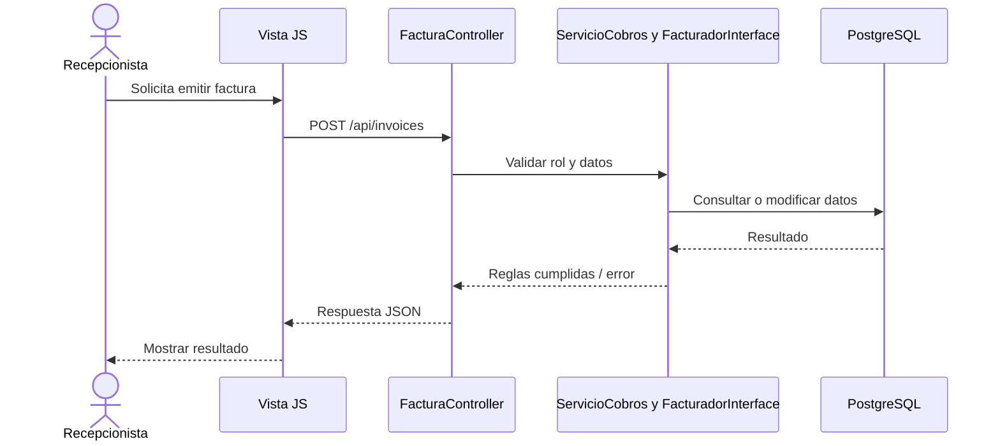

**Regla principal:** Calcular importe y guardar factura vinculada a cita.

## CU12 — Registrar pago

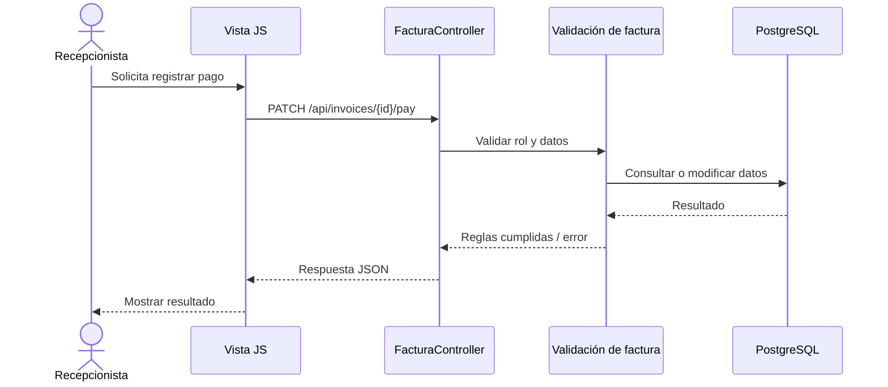

**Regla principal:** Marcar emitida como pagada y notificar.

## CU13 — Consultar facturas

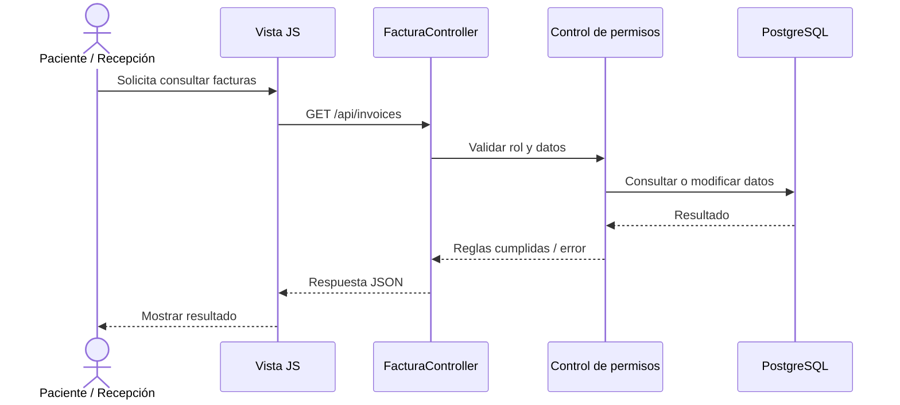

**Regla principal:** Filtrar facturación propia en perfil paciente.

## CU14 — Gestionar notificaciones

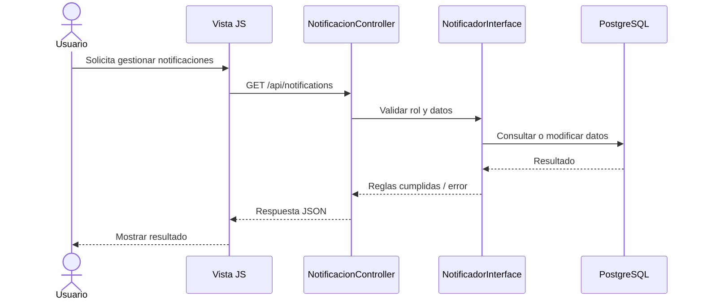

**Regla principal:** Listar avisos y marcar leído con PATCH.

## CU15 — Alta de paciente en recepción

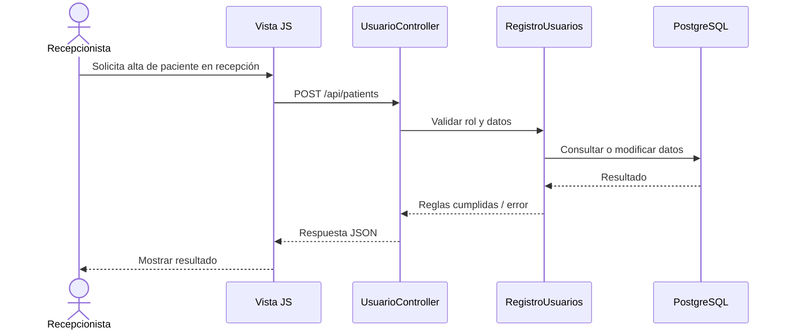

**Regla principal:** Crear cuenta con perfil de paciente.

## CU16 — Consultar indicadores

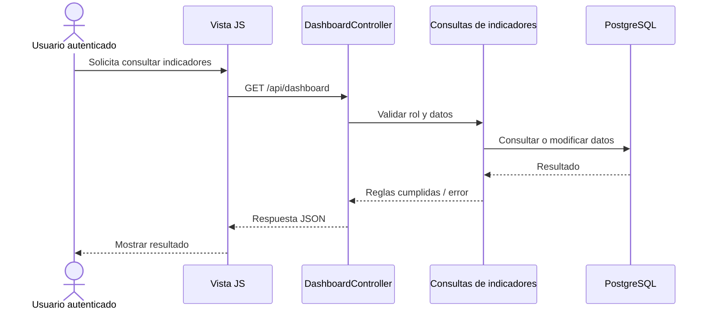

**Regla principal:** Filtrar datos según perfil de acceso.

## Arquitectura lógica: paquetes

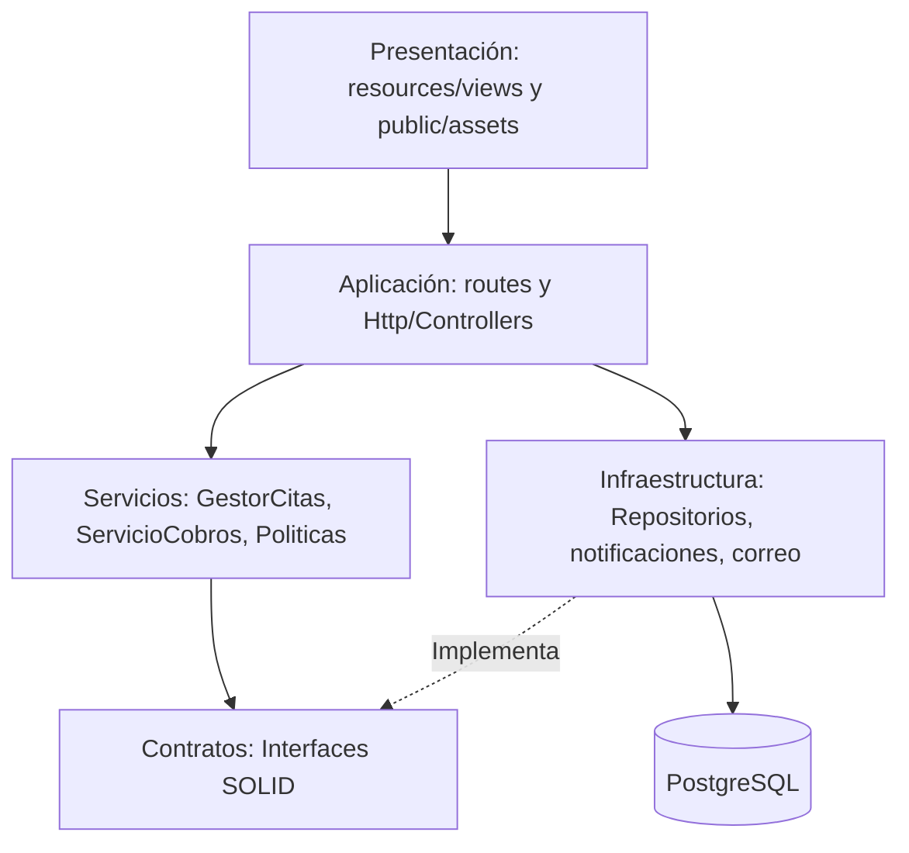

## Arquitectura física: despliegue local y nube

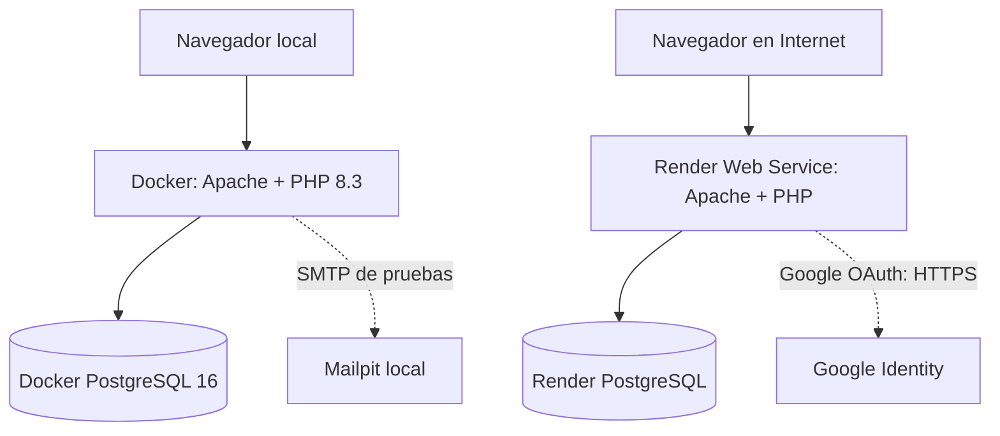

## Funcionalidades complementarias

- **Google OIDC:** autentica mediante la cuenta previamente vinculada, sin conceder rol nuevo.
- **Bitácora:** triggers en PostgreSQL registran INSERT/UPDATE/DELETE en tablas supervisadas.
- **Tratamientos:** nueva ampliación de la segunda semana, ligada a CU09 y CU10; no altera el número original de CU.

## Revisión previa a la entrega

- Actualizar la versión DOCX/PDF para incorporar los diagramas de diseño y las funciones nuevas.
- Comprobar cada diagrama con un recorrido real por la aplicación y capturas de ejecución.
- Comprobar que las reglas de seguridad se respetan con los cuatro roles y que la base de datos se inicializa correctamente.
