# SISTEMA WEB DE GESTIÓN DE CITAS MÉDICAS — SALUDCITA

**Documento base del proyecto · Captura de requisitos y análisis · Versión 3 (23 de octubre de 2026)**

**Alcance documental:** perfil, marco teórico, modelo de negocio, flujo de trabajo de captura de requisitos (1.1–1.5) y flujo de trabajo de análisis (2.1–2.4), con numeración de capítulos siguiendo la estructura de referencia aportada. El diseño físico y la implementación completa constituyen el siguiente bloque del proceso, aunque se adjunta un software ejecutable como evidencia.

\newpage

# CONTENIDO Y EVIDENCIAS

Este documento contiene secciones equivalentes a las indicadas en la pizarra y en el índice del trabajo de referencia; sus datos y diagramas están adaptados al dominio médico, no copiados del proyecto de horarios académicos. Cada caso de uso cuenta con identificación, prioridad, descripción, prototipo identificado, diagrama de comunicación y clase o componente de análisis asociado.

| Sección solicitada | Evidencia del proyecto |
| --- | --- |
| Perfil y alcance | Problema, objetivos, fronteras y reglas |
| Marco teórico | Proceso Unificado, UML, arquitectura de capas, SOLID |
| Modelo de negocio | Cuatro diagramas de actividad |
| 1.1–1.5 Captura | Cuatro actores, 16 casos en dos ciclos, fichas y prototipos |
| 2.1 Arquitectura | Seis paquetes, trazabilidad de casos y dependencias |
| 2.2 Comunicación | 16 diagramas de comunicación |
| 2.3 Clases | Modelo SOLID y análisis de entidades, atributos y métodos por CU |
| 2.4 Paquetes | Relaciones, responsabilidades y justificación técnica |

\newpage

# 1. PERFIL

## 1.1. INTRODUCCIÓN

SaludCita es un sistema web académico diseñado para la organización de consultas médicas en centros de atención ambulatoria. Digitaliza el registro de pacientes y profesionales, la oferta de horarios, la solicitud de citas, el registro de atención médica, la emisión de comprobantes internos y las notificaciones. Se ejecuta mediante un servidor PHP/Apache y una base de datos PostgreSQL; su interfaz está construida con HTML, CSS y JavaScript.

La propuesta surge de la necesidad de evitar reservas dobles y registros dispersos. Se desarrolla de forma incremental mediante casos de uso que permiten identificar acciones del Paciente, Recepcionista, Médico y Administrador. El proyecto no pretende cubrir internación, farmacia, prescripciones verificadas, servicios de aseguradoras ni facturación tributaria oficial.

## 1.2. OBJETIVO GENERAL

Desarrollar un sistema web modular de citas médicas que permita gestionar pacientes, médicos, horarios, consultas, pagos y avisos, preservando la integridad de las reservas y separando las responsabilidades con principios SOLID, para facilitar el mantenimiento y la ampliación del software.

## 1.3. OBJETIVOS ESPECÍFICOS

- Identificar actores y documentar sus casos de uso en dos ciclos de trabajo.
- Crear un mecanismo de autenticación y autorización por roles con acceso diferenciado.
- Registrar catálogos médicos, especialidades, pacientes y horarios semanales.
- Validar que ninguna cita activa duplique el turno de un médico o de un paciente.
- Registrar atenciones clínicas vinculadas a citas realizadas, respetando la visibilidad por rol.
- Emitir facturas internas de demostración con estrategias de cálculo extensibles y estado de pago.
- Notificar eventos relevantes y mantener un historial de mensajes por usuario.
- Preparar artefactos UML de actividad, casos de uso, comunicación, clases y paquetes, con trazabilidad al código.

## 1.4. DESCRIPCIÓN DEL PROBLEMA

En una recepción con registro manual o agendas separadas se presentan conflictos de turnos, demoras al ubicar historiales, dificultad para conocer pagos pendientes y comunicación tardía de confirmaciones o cancelaciones. Si toda la funcionalidad se concentra en un único archivo, cualquier cambio de facturación o notificaciones puede ocasionar modificaciones accidentales en la programación de citas. SaludCita responde a estos riesgos mediante una agenda centralizada, políticas de estados, controles de acceso y componentes independientes.

## 1.5. ALCANCE

**Incluido en la aplicación:** inicio de sesión, registro público de pacientes, gestión de usuarios de personal, catálogos de médicos y especialidades, horarios semanales, agenda con intervalos de treinta minutos, cancelación/confirmación/finalización según rol, historia clínica básica por consulta, facturación demostrativa normal/con descuento, registro de pago, avisos en el sistema y dashboard contextual. **No incluido:** correo electrónico o WhatsApp reales, cobros bancarios, recetas electrónicas oficiales, integración de seguros, historia clínica interoperable, gestión de hospitalización ni despliegue público en la nube.

## 1.6. REQUISITOS Y REGLAS OPERATIVAS

| Código | Requisito funcional / regla verificable |
| --- | --- |
| RF01 | Login y cuenta con rol; sin sesión no se permite usar rutas privadas |
| RF02 | El paciente puede registrarse y reservar citas propias |
| RF03 | El administrador registra médicos, especialidades y franjas horarias |
| RF04 | Recepción y administración pueden registrar pacientes |
| RF05 | La cita debe ser futura, iniciar en minuto 00/30 y encajar en horario habilitado |
| RF06 | PostgreSQL evita la doble reserva activa por médico y por paciente |
| RF07 | La transición entre estados se autoriza según rol y estado actual |
| RF08 | El médico responsable registra síntomas, diagnóstico y tratamiento |
| RF09 | Se emite una factura por cita confirmada/completada; no se duplica |
| RF10 | Recepción y administración pueden registrar un pago |
| RF11 | Se generan y consultan notificaciones internas |
| RF12 | Cada rol consulta sus datos o los autorizados |

| Código | Requisito no funcional |
| --- | --- |
| RNF01 | Seguridad de sesión, hashing de contraseñas, CSRF y roles |
| RNF02 | Interfaz adaptativa de escritorio y móvil; formularios etiquetados |
| RNF03 | Persistencia PostgreSQL con restricciones e integridad referencial |
| RNF04 | Arquitectura modular y extensible por contratos |
| RNF05 | Ejecución reproducible con Docker Compose |
| RNF06 | Sistema de demostración: no introducir datos clínicos reales sin revisión de seguridad, privacidad y normativa |

# 2. MARCO TEÓRICO

## 2.1. MARCO TEÓRICO METODOLÓGICO

**Proceso Unificado de Desarrollo de Software (PUDS):** método iterativo dirigido por casos de uso y centrado en arquitectura. En SaludCita el primer ciclo organiza los usuarios, catálogos, horarios y reservas; el segundo añade historias clínicas, cobros y avisos. Los flujos de requisitos, análisis, diseño e implementación producen artefactos relacionados y permiten retroalimentación por iteración.

**UML (Unified Modeling Language):** notación para representar comportamiento y estructura del sistema. Los diagramas de actividades describen procesos; los casos de uso delimitan objetivos de los actores; los diagramas de comunicación representan interacción mediante mensajes numerados; los diagramas de clases reflejan atributos y operaciones; los diagramas de paquetes muestran agrupaciones y dependencias. En análisis, las clases pueden ser conceptuales y no necesariamente idénticas a las clases PHP actuales.

**SOLID:** SRP separa responsabilidad de coordinación, disponibilidad, almacenamiento y notificación; OCP permite nuevas estrategias de facturación sin cambiar el servicio de cobro; DIP hace que servicios dependan de interfaces y no de una base de datos concreta. Los cinco principios son guías de diseño, no un mecanismo automático de seguridad.

## 2.2. MARCO TEÓRICO REFERENCIAL

**Dominio de citas médicas:** una cita vincula un paciente y un médico en un horario con un motivo y un estado. Una consulta clínica puede registrar síntomas, diagnóstico y tratamiento, vinculándose a una cita previa. Una factura interna representa un monto por una atención, no un documento fiscal. El control de acceso restringe quién puede ver registros clínicos, modificar citas y registrar pagos. La interfaz procura comunicar claramente estados y errores para reducir acciones accidentales.

# 3. MODELO DE NEGOCIO

El modelo de negocio describe los procesos principales antes de entrar en el diseño técnico. Cada figura muestra los pasos y las salidas de error más importantes; las restricciones formales también se expresan en la sección de requisitos.

## DIAGRAMA DE ACTIVIDADES — ACCESO AL SISTEMA Y CARGA DE PERMISOS

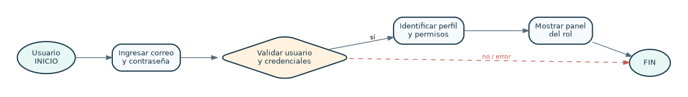

*Figura. Acceso al sistema y carga de permisos. Elaboración propia para SaludCita.*

## DIAGRAMA DE ACTIVIDADES — AGENDAMIENTO Y CONFIRMACIÓN DE CITAS

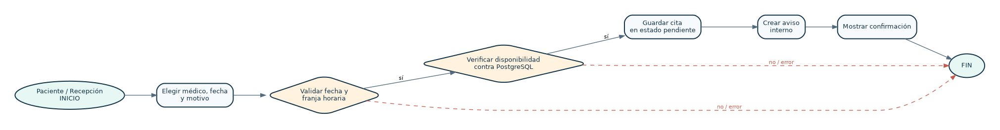

*Figura. Agendamiento y confirmación de citas. Elaboración propia para SaludCita.*

## DIAGRAMA DE ACTIVIDADES — REGISTRO DE ATENCIÓN E HISTORIA CLÍNICA

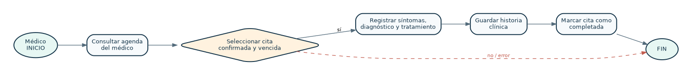

*Figura. Registro de atención e historia clínica. Elaboración propia para SaludCita.*

## DIAGRAMA DE ACTIVIDADES — FACTURACIÓN Y REGISTRO DE PAGOS

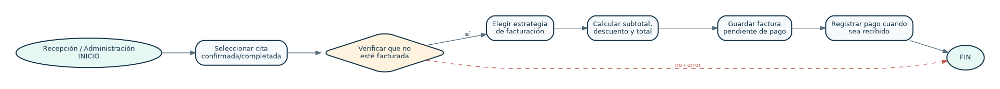

*Figura. Facturación y registro de pagos. Elaboración propia para SaludCita.*

\newpage

# 2. FLUJO DE TRABAJO: CAPTURA DE REQUISITOS

## 2.1. DISEÑAR CASOS DE USO

### 2.1.1. ACTORES

| Actor | Responsabilidad y restricciones |
| --- | --- |
| Paciente | Se registra, consulta médicos, agenda y cancela sus citas; revisa sus propios registros, pagos y avisos. |
| Recepcionista | Registra pacientes, consulta y confirma citas, emite facturas internas y marca pagos. |
| Médico | Consulta su agenda, registra la atención de sus propias citas e identifica historias permitidas. |
| Administrador | Gestiona usuarios, médicos, especialidades, horarios y operaciones permitidas de agenda y facturación. |

### 2.1.2. CASOS DE USO

| ID | Caso de uso | Actor/es | Ciclo |
| --- | --- | --- | --- |
| CU01 | Iniciar sesión | Todos los roles | C1 |
| CU02 | Registrar cuenta de paciente | Paciente | C1 |
| CU03 | Administrar usuarios y roles | Administrador | C1 |
| CU04 | Gestionar médicos y especialidades | Administrador | C1 |
| CU05 | Configurar horarios de médicos | Administrador | C1 |
| CU06 | Agendar una cita médica | Paciente, Recepcionista, Administrador | C1 |
| CU07 | Consultar agenda de citas | Todos los roles | C1 |
| CU08 | Gestionar estado de una cita | Paciente, Recepcionista, Médico, Administrador | C1 |
| CU09 | Registrar consulta e historia clínica | Médico | C2 |
| CU10 | Consultar historia clínica | Paciente, Médico | C2 |
| CU11 | Emitir factura de consulta | Recepcionista, Administrador | C2 |
| CU12 | Registrar pago de factura | Recepcionista, Administrador | C2 |
| CU13 | Consultar facturas y saldos | Paciente, Recepcionista, Administrador | C2 |
| CU14 | Consultar y marcar notificaciones | Todos los roles | C2 |
| CU15 | Registrar paciente desde recepción | Recepcionista, Administrador | C2 |
| CU16 | Consultar panel de indicadores | Todos los roles | C2 |

## 2.2. PRIORIZAR CASOS DE USO Y ESTADO

La prioridad se define como Alta, Crítica o Media en función de impacto y dependencia; el riesgo (Bajo, Medio o Alto) estima dificultad técnica o seguridad. El estado “Aprobado” indica incluido en el alcance del prototipo académico, no certifica una prueba de integración exhaustiva.

| ID | Prioridad | Riesgo | Estado | Ciclo |
| --- | --- | --- | --- | --- |
| CU01 | Alta | Medio | Aprobado | C1 |
| CU02 | Alta | Medio | Aprobado | C1 |
| CU03 | Alta | Medio | Aprobado | C1 |
| CU04 | Alta | Medio | Aprobado | C1 |
| CU05 | Alta | Alto | Aprobado | C1 |
| CU06 | Crítica | Alto | Aprobado | C1 |
| CU07 | Alta | Medio | Aprobado | C1 |
| CU08 | Crítica | Alto | Aprobado | C1 |
| CU09 | Crítica | Alto | Aprobado | C2 |
| CU10 | Alta | Alto | Aprobado | C2 |
| CU11 | Alta | Alto | Aprobado | C2 |
| CU12 | Alta | Medio | Aprobado | C2 |
| CU13 | Media | Medio | Aprobado | C2 |
| CU14 | Media | Bajo | Aprobado | C2 |
| CU15 | Alta | Medio | Aprobado | C2 |
| CU16 | Media | Bajo | Aprobado | C2 |

## 2.3. DETALLAR UN CASO DE USO

Cada ficha contiene propósito, iniciador, precondiciones, escenario principal, postcondiciones, excepciones y referencia a módulo implementado. Las acciones descritas siguen la interfaz actual y las rutas del proyecto; no se incluyen funciones de producción inexistentes.

### CICLO #1

#### CU01 — INICIAR SESIÓN

| Elemento | Descripción |
| --- | --- |
| Propósito | Iniciar sesión |
| Actor iniciador | Todos los roles |
| Precondición | Usuario activo registrado |
| Flujo principal | 1. Ingresar correo y contraseña. 2. El usuario recibe su panel según el rol; las credenciales se comprueban en el servidor. 3. Se presenta la respuesta en pantalla. |
| Postcondición | Sesión iniciada con rol verificado |
| Excepción / flujo alternativo | Credenciales erróneas, cuenta inactiva, fallo del servidor |
| Prioridad / riesgo | Alta / Medio |
| Implementación | AuthController.login; Auth.login |

**PROTOTIPO CU01:** /paciente, /recepcionista, /medico, /administrador. La pantalla está implementada mediante vistas generadas desde `public/assets/app.js`, y datos del servidor PHP. Su disponibilidad depende del rol.

#### CU02 — REGISTRAR CUENTA DE PACIENTE

| Elemento | Descripción |
| --- | --- |
| Propósito | Registrar cuenta de paciente |
| Actor iniciador | Paciente |
| Precondición | Documento y correo disponibles |
| Flujo principal | 1. Abrir crear cuenta y llenar datos personales. 2. El sistema comprueba duplicados, crea usuario y perfil de paciente. 3. Se presenta la respuesta en pantalla. |
| Postcondición | Paciente registrado; puede iniciar sesión |
| Excepción / flujo alternativo | Correo/CI duplicado, contraseña inválida |
| Prioridad / riesgo | Alta / Medio |
| Implementación | AuthController.register; RegistroUsuarios |

**PROTOTIPO CU02:** Login → Crear cuenta de paciente. La pantalla está implementada mediante vistas generadas desde `public/assets/app.js`, y datos del servidor PHP. Su disponibilidad depende del rol.

#### CU03 — ADMINISTRAR USUARIOS Y ROLES

| Elemento | Descripción |
| --- | --- |
| Propósito | Administrar usuarios y roles |
| Actor iniciador | Administrador |
| Precondición | Administrador autenticado |
| Flujo principal | 1. Acceder a Usuarios y crear personal. 2. Asignar un rol autorizado y guardar un usuario nuevo. 3. Se presenta la respuesta en pantalla. |
| Postcondición | Cuenta registrada con rol asignado |
| Excepción / flujo alternativo | Correo duplicado o rol no permitido |
| Prioridad / riesgo | Alta / Medio |
| Implementación | UsuarioController.crearUsuario |

**PROTOTIPO CU03:** Panel → Usuarios. La pantalla está implementada mediante vistas generadas desde `public/assets/app.js`, y datos del servidor PHP. Su disponibilidad depende del rol.

#### CU04 — GESTIONAR MÉDICOS Y ESPECIALIDADES

| Elemento | Descripción |
| --- | --- |
| Propósito | Gestionar médicos y especialidades |
| Actor iniciador | Administrador |
| Precondición | Administrador autenticado; catálogo disponible |
| Flujo principal | 1. Registrar especialidad y médico. 2. Guardar datos profesionales, precio y especialidad válida. 3. Se presenta la respuesta en pantalla. |
| Postcondición | Médico vinculado a usuario y especialidad |
| Excepción / flujo alternativo | Especialidad inexistente, correo repetido |
| Prioridad / riesgo | Alta / Medio |
| Implementación | CatalogoController.crearMedico/crearEspecialidad |

**PROTOTIPO CU04:** Panel → Especialidades / Médicos. La pantalla está implementada mediante vistas generadas desde `public/assets/app.js`, y datos del servidor PHP. Su disponibilidad depende del rol.

#### CU05 — CONFIGURAR Y ELIMINAR HORARIOS DE MÉDICOS

| Elemento | Descripción |
| --- | --- |
| Propósito | Crear y eliminar horarios semanales de médicos, preservando las citas ya comprometidas |
| Actor iniciador | Administrador |
| Precondición | Médico registrado |
| Flujo principal | 1. Crear: seleccionar médico, día e intervalo; validar solapes y guardar. 2. Eliminar: elegir una franja sin citas futuras activas, confirmar y retirar el horario. 3. Actualizar la lista. |
| Postcondición | Horario de atención disponible para reservas |
| Excepción / flujo alternativo | Hora final anterior, horario superpuesto, médico inexistente; al eliminar, bloquear si hay citas futuras pendientes o confirmadas (HTTP 409) |
| Prioridad / riesgo | Alta / Alto |
| Implementación | HorarioController (index, crear, eliminar), ServicioHorarios.eliminar, PostgreSQL schedules, rutas GET/POST/DELETE /api/schedules |

**PROTOTIPO CU05:** `/administrador/horarios` (crear y eliminar horarios). La pantalla está implementada mediante vistas generadas desde `public/assets/app.js`, y datos del servidor PHP. Su disponibilidad depende del rol.

#### CU06 — AGENDAR UNA CITA MÉDICA

| Elemento | Descripción |
| --- | --- |
| Propósito | Agendar una cita médica |
| Actor iniciador | Paciente, Recepcionista, Administrador |
| Precondición | Paciente y médico existentes; sesión válida |
| Flujo principal | 1. Seleccionar paciente (si corresponde), médico, fecha y motivo. 2. Validar fecha futura y disponibilidad; persistir cita pendiente; notificar. 3. Se presenta la respuesta en pantalla. |
| Postcondición | Cita pendiente almacenada y aviso generado |
| Excepción / flujo alternativo | Horario ocupado, fuera de jornada, fecha pasada |
| Prioridad / riesgo | Crítica / Alto |
| Implementación | CitaController.agendar; GestorCitas |

**PROTOTIPO CU06:** Panel → Citas médicas → Agendar. La pantalla está implementada mediante vistas generadas desde `public/assets/app.js`, y datos del servidor PHP. Su disponibilidad depende del rol.

#### CU07 — CONSULTAR AGENDA DE CITAS

| Elemento | Descripción |
| --- | --- |
| Propósito | Consultar agenda de citas |
| Actor iniciador | Todos los roles |
| Precondición | Sesión activa |
| Flujo principal | 1. Abrir Citas médicas. 2. El sistema consulta únicamente las citas permitidas para el rol. 3. Se presenta la respuesta en pantalla. |
| Postcondición | Agenda consultada |
| Excepción / flujo alternativo | Sin citas, fallo de conexión |
| Prioridad / riesgo | Alta / Medio |
| Implementación | CitaController.index |

**PROTOTIPO CU07:** Panel → Citas médicas. La pantalla está implementada mediante vistas generadas desde `public/assets/app.js`, y datos del servidor PHP. Su disponibilidad depende del rol.

#### CU08 — GESTIONAR ESTADO DE UNA CITA

| Elemento | Descripción |
| --- | --- |
| Propósito | Gestionar estado de una cita |
| Actor iniciador | Paciente, Recepcionista, Médico, Administrador |
| Precondición | Cita existente, rol autorizado |
| Flujo principal | 1. Confirmar, cancelar o completar cita según rol. 2. Validar transición de estados y actualizar registro, generando aviso. 3. Se presenta la respuesta en pantalla. |
| Postcondición | Estado actualizado y paciente informado |
| Excepción / flujo alternativo | Transición prohibida, cita cambiada por otro usuario |
| Prioridad / riesgo | Crítica / Alto |
| Implementación | CitaController.cambiarEstado; PoliticaEstadosCita |

**PROTOTIPO CU08:** Panel → Citas médicas → Acciones. La pantalla está implementada mediante vistas generadas desde `public/assets/app.js`, y datos del servidor PHP. Su disponibilidad depende del rol.

### CICLO #2

#### CU09 — REGISTRAR CONSULTA E HISTORIA CLÍNICA

| Elemento | Descripción |
| --- | --- |
| Propósito | Registrar consulta e historia clínica |
| Actor iniciador | Médico |
| Precondición | Médico autenticado; cita confirmada y pasada/actual |
| Flujo principal | 1. Elegir cita atendida y escribir datos clínicos. 2. Validar que sea cita propia y válida; guardar síntomas, diagnóstico y tratamiento. 3. Se presenta la respuesta en pantalla. |
| Postcondición | Historia clínica registrada y cita completada |
| Excepción / flujo alternativo | Cita ajena, historia duplicada, datos faltantes |
| Prioridad / riesgo | Crítica / Alto |
| Implementación | HistoriaClinicaController.registrar |

**PROTOTIPO CU09:** Panel → Historias clínicas. La pantalla está implementada mediante vistas generadas desde `public/assets/app.js`, y datos del servidor PHP. Su disponibilidad depende del rol.

#### CU10 — CONSULTAR HISTORIA CLÍNICA

| Elemento | Descripción |
| --- | --- |
| Propósito | Consultar historia clínica |
| Actor iniciador | Paciente, Médico |
| Precondición | Cuenta autenticada y registro existente |
| Flujo principal | 1. Abrir Historias clínicas. 2. La consulta devuelve solo registros autorizados por el perfil. 3. Se presenta la respuesta en pantalla. |
| Postcondición | Historia visualizada sin modificación |
| Excepción / flujo alternativo | Acceso no autorizado, inexistencia de datos |
| Prioridad / riesgo | Alta / Alto |
| Implementación | HistoriaClinicaController.index |

**PROTOTIPO CU10:** Panel → Historias clínicas. La pantalla está implementada mediante vistas generadas desde `public/assets/app.js`, y datos del servidor PHP. Su disponibilidad depende del rol.

#### CU11 — EMITIR FACTURA DE CONSULTA

| Elemento | Descripción |
| --- | --- |
| Propósito | Emitir factura de consulta |
| Actor iniciador | Recepcionista, Administrador |
| Precondición | Cita confirmada o completada sin factura |
| Flujo principal | 1. Seleccionar cita y modalidad normal/seguro. 2. Seleccionar clase de facturador, calcular valores y guardar factura. 3. Se presenta la respuesta en pantalla. |
| Postcondición | Factura emitida con subtotal, descuento y total |
| Excepción / flujo alternativo | Factura duplicada, tipo desconocido |
| Prioridad / riesgo | Alta / Alto |
| Implementación | FacturaController.emitir; ServicioCobros |

**PROTOTIPO CU11:** Panel → Facturación → Emitir. La pantalla está implementada mediante vistas generadas desde `public/assets/app.js`, y datos del servidor PHP. Su disponibilidad depende del rol.

#### CU12 — REGISTRAR PAGO DE FACTURA

| Elemento | Descripción |
| --- | --- |
| Propósito | Registrar pago de factura |
| Actor iniciador | Recepcionista, Administrador |
| Precondición | Factura existente en estado emitida |
| Flujo principal | 1. Seleccionar factura emitida y registrar pago. 2. Cambiar estado a pagada y registrar fecha de pago. 3. Se presenta la respuesta en pantalla. |
| Postcondición | Factura marcada pagada |
| Excepción / flujo alternativo | Factura inexistente o ya pagada |
| Prioridad / riesgo | Alta / Medio |
| Implementación | FacturaController.pagar |

**PROTOTIPO CU12:** Panel → Facturación → Registrar pago. La pantalla está implementada mediante vistas generadas desde `public/assets/app.js`, y datos del servidor PHP. Su disponibilidad depende del rol.

#### CU13 — CONSULTAR FACTURAS Y SALDOS

| Elemento | Descripción |
| --- | --- |
| Propósito | Consultar facturas y saldos |
| Actor iniciador | Paciente, Recepcionista, Administrador |
| Precondición | Usuario autenticado |
| Flujo principal | 1. Abrir Facturación. 2. Mostrar registros visibles, total pendiente y estado de pagos. 3. Se presenta la respuesta en pantalla. |
| Postcondición | Facturas y saldos consultados |
| Excepción / flujo alternativo | Sin facturas o fallo del servidor |
| Prioridad / riesgo | Media / Medio |
| Implementación | FacturaController.index |

**PROTOTIPO CU13:** Panel → Facturación. La pantalla está implementada mediante vistas generadas desde `public/assets/app.js`, y datos del servidor PHP. Su disponibilidad depende del rol.

#### CU14 — CONSULTAR Y MARCAR NOTIFICACIONES

| Elemento | Descripción |
| --- | --- |
| Propósito | Consultar y marcar notificaciones |
| Actor iniciador | Todos los roles |
| Precondición | Usuario autenticado |
| Flujo principal | 1. Abrir campana o sección Notificaciones. 2. Listar mensajes y registrar fecha de lectura al marcarlos. 3. Se presenta la respuesta en pantalla. |
| Postcondición | Notificación consultada y marcada leída |
| Excepción / flujo alternativo | Notificación inexistente o ajena |
| Prioridad / riesgo | Media / Bajo |
| Implementación | NotificacionController.index/marcarLeida |

**PROTOTIPO CU14:** Barra superior → Campana / Notificaciones. La pantalla está implementada mediante vistas generadas desde `public/assets/app.js`, y datos del servidor PHP. Su disponibilidad depende del rol.

#### CU15 — REGISTRAR PACIENTE DESDE RECEPCIÓN

| Elemento | Descripción |
| --- | --- |
| Propósito | Registrar paciente desde recepción |
| Actor iniciador | Recepcionista, Administrador |
| Precondición | Personal autorizado |
| Flujo principal | 1. Abrir Pacientes, ingresar datos y guardar. 2. Validar identidad, correo y contraseña; crear registro. 3. Se presenta la respuesta en pantalla. |
| Postcondición | Paciente disponible para agendar |
| Excepción / flujo alternativo | CI o correo duplicado |
| Prioridad / riesgo | Alta / Medio |
| Implementación | UsuarioController.crearPaciente |

**PROTOTIPO CU15:** Panel → Pacientes. La pantalla está implementada mediante vistas generadas desde `public/assets/app.js`, y datos del servidor PHP. Su disponibilidad depende del rol.

#### CU16 — CONSULTAR PANEL DE INDICADORES

| Elemento | Descripción |
| --- | --- |
| Propósito | Consultar panel de indicadores |
| Actor iniciador | Todos los roles |
| Precondición | Sesión autenticada |
| Flujo principal | 1. Entrar al panel principal. 2. Obtener indicadores de citas visibles, recientes y no leídas. 3. Se presenta la respuesta en pantalla. |
| Postcondición | Dashboard contextual al rol |
| Excepción / flujo alternativo | Sin registros; error de conexión |
| Prioridad / riesgo | Media / Bajo |
| Implementación | DashboardController.index |

**PROTOTIPO CU16:** Panel → Resumen. La pantalla está implementada mediante vistas generadas desde `public/assets/app.js`, y datos del servidor PHP. Su disponibilidad depende del rol.

### PROTOTIPOS VISUALES DE INTERFAZ DE USUARIO

Los siguientes prototipos se capturaron sobre la interfaz HTML/CSS/JavaScript de SaludCita v3. Para las vistas autenticadas se utilizaron respuestas de demostración simuladas durante la comprobación visual; las imágenes muestran diseño y navegación, **no prueban por sí solas el funcionamiento de PostgreSQL**.

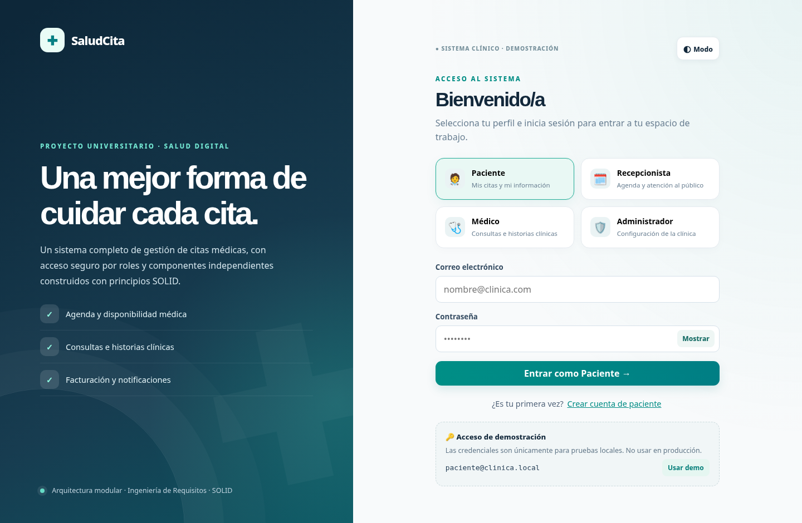

*Prototipo de acceso para los cuatro actores.*

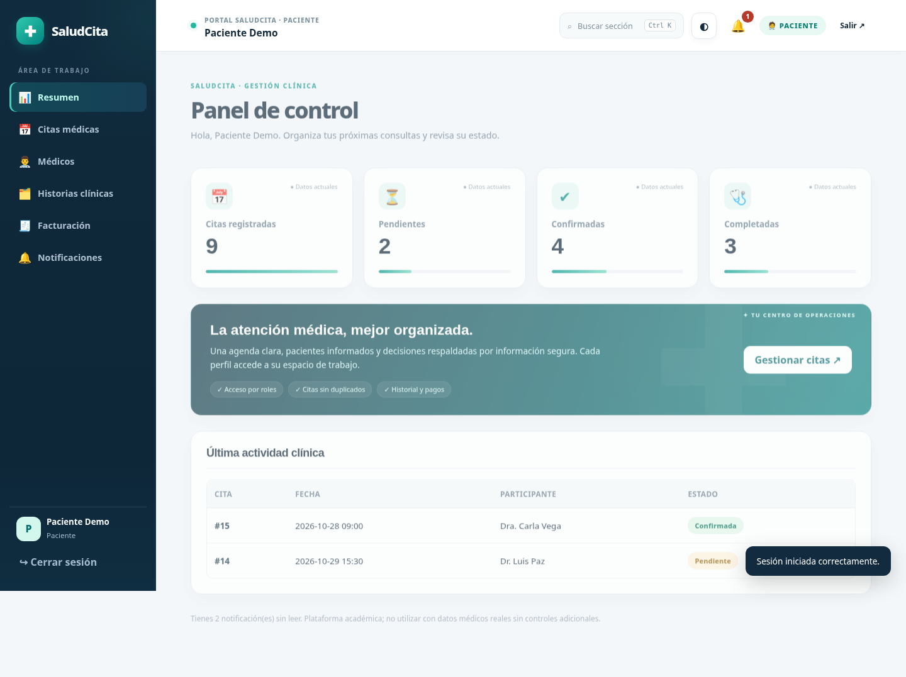

*Prototipo de panel contextual del Paciente (datos simulados en prueba visual).*

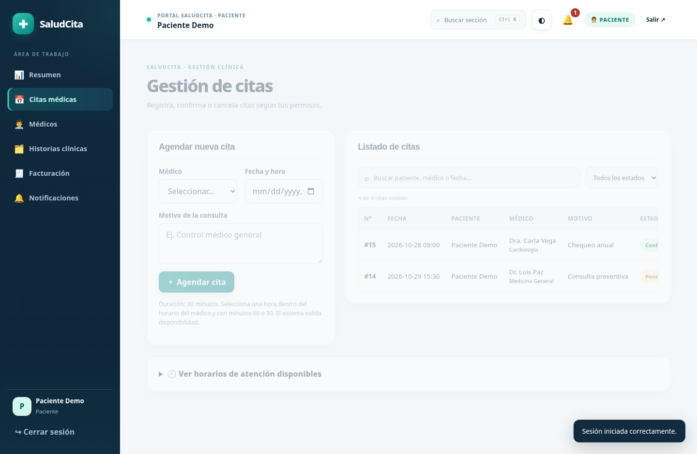

*Prototipo de agendamiento y filtro de citas.*

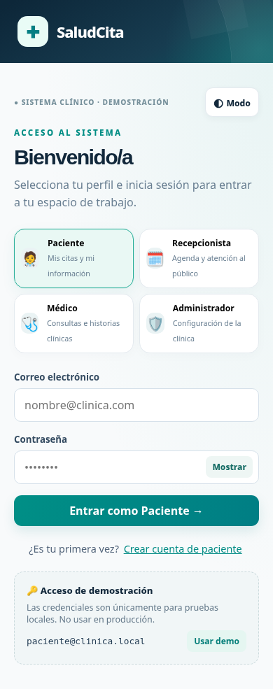

*Prototipo responsive de acceso en teléfono.*

## 2.4. ESTRUCTURAR MODELOS DE CASOS DE USO

### CICLO #1

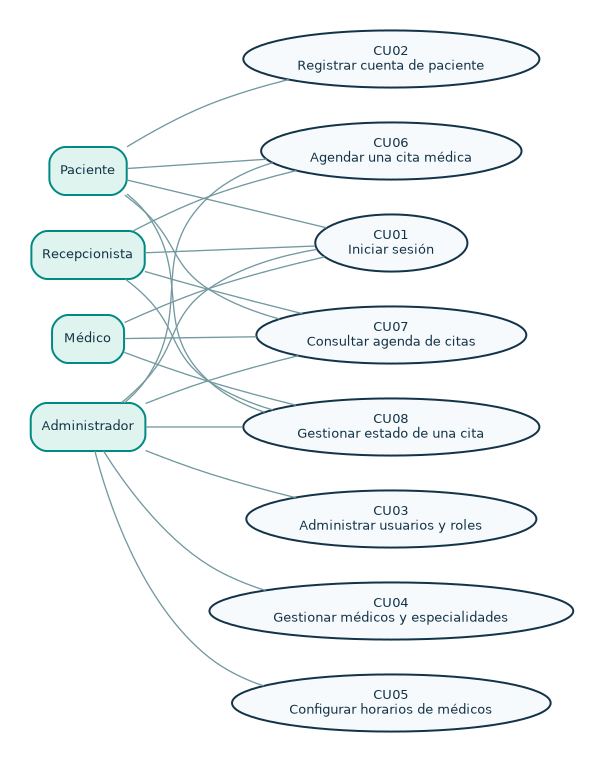

*Figura. Modelo de casos de uso del ciclo 1 (acceso, catálogos y citas). Elaboración propia para SaludCita.*

### CICLO #2

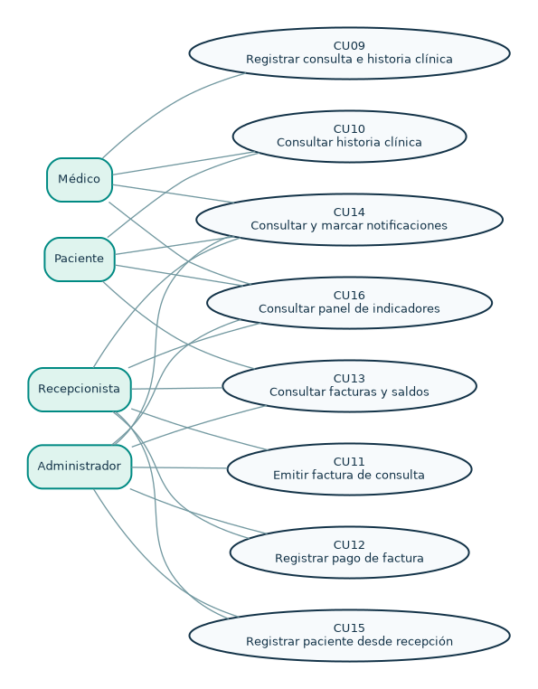

*Figura. Modelo de casos de uso del ciclo 2 (atención, facturas y avisos). Elaboración propia para SaludCita.*

### DIAGRAMA GENERAL

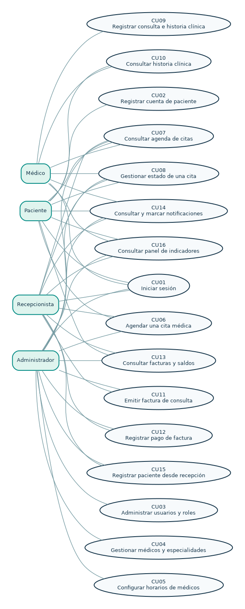

*Figura. Modelo general de casos de uso de SaludCita. Elaboración propia para SaludCita.*

\newpage

# 3. FLUJO DE TRABAJO: ANÁLISIS

## 3.1. ANÁLISIS DE ARQUITECTURA

### 3.1.1. IDENTIFICAR PAQUETES

| Paquete | Responsabilidad | Ejemplos de implementación |
| --- | --- | --- |
| P1 · Acceso y seguridad | Credenciales, roles, sesión y CSRF | AuthController, Auth, RegistroUsuarios |
| P2 · Catálogo clínico | Pacientes, médicos, especialidades y horarios | CatalogoController, UsuarioController |
| P3 · Gestión de citas | Reservas, disponibilidad y política de estados | GestorCitas, ValidadorDisponibilidad, PoliticaEstadosCita |
| P4 · Atención clínica | Historias y registros de atención por cita | HistoriaClinicaController, tabla clinical_records |
| P5 · Cobros | Cálculo independiente, facturación y pagos | ServicioCobros, Facturadores, FacturaRepository |
| P6 · Comunicación | Historial de avisos y envío interno | NotificadorInterface, NotificadorEnSistema |

### 3.1.2. RELACIONAR PAQUETES Y CASOS DE USO

| Paquete | Casos de uso que implementa principalmente | Relaciones transversales |
| --- | --- | --- |
| P1 | CU01, CU02, CU03 | Todos consultan P1 para autorización; P3 y P5 activan avisos P6 cuando corresponde |
| P2 | CU04, CU05, CU15 | Todos consultan P1 para autorización; P3 y P5 activan avisos P6 cuando corresponde |
| P3 | CU06, CU07, CU08, CU16 | Todos consultan P1 para autorización; P3 y P5 activan avisos P6 cuando corresponde |
| P4 | CU09, CU10 | Todos consultan P1 para autorización; P3 y P5 activan avisos P6 cuando corresponde |
| P5 | CU11, CU12, CU13 | Todos consultan P1 para autorización; P3 y P5 activan avisos P6 cuando corresponde |
| P6 | CU14 | Todos consultan P1 para autorización; P3 y P5 activan avisos P6 cuando corresponde |

### 3.1.3. VISTA DE PAQUETE

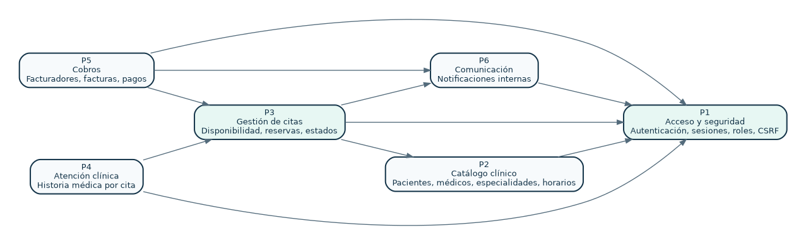

*Figura. Paquetes de análisis y dependencias de SaludCita. Elaboración propia para SaludCita.*

**Lectura de flechas:** la dependencia de origen necesita capacidades del paquete destino, pero las dependencias de código pueden resolverse mediante contratos. El diagrama es lógico y no describe necesariamente todas las dependencias internas de infraestructura.

## 3.2. ANÁLISIS DE CASOS DE USO

### 3.2.1. DIAGRAMAS DE COMUNICACIÓN

Cada diagrama tiene actor, objeto límite («boundary»: formulario o vista), controlador («control») y entidad/contrato («entity»). Las flechas numeradas simplifican el intercambio; la operación concreta depende de los métodos y las reglas del servidor.

#### CICLO #1

##### CU01 · Iniciar sesión

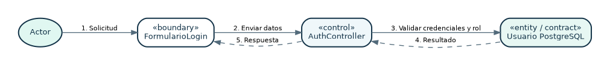

*Figura. Comunicación del caso CU01: Iniciar sesión. Elaboración propia para SaludCita.*

##### CU02 · Registrar cuenta de paciente

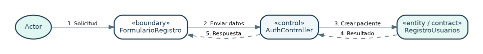

*Figura. Comunicación del caso CU02: Registrar cuenta de paciente. Elaboración propia para SaludCita.*

##### CU03 · Administrar usuarios y roles

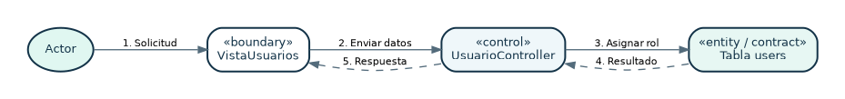

*Figura. Comunicación del caso CU03: Administrar usuarios y roles. Elaboración propia para SaludCita.*

##### CU04 · Gestionar médicos y especialidades

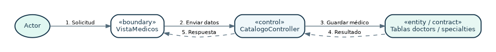

*Figura. Comunicación del caso CU04: Gestionar médicos y especialidades. Elaboración propia para SaludCita.*

##### CU05 · Configurar horarios de médicos

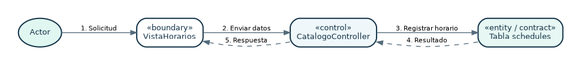

*Figura. Comunicación del caso CU05: Configurar horarios de médicos. Elaboración propia para SaludCita.*

##### CU06 · Agendar una cita médica

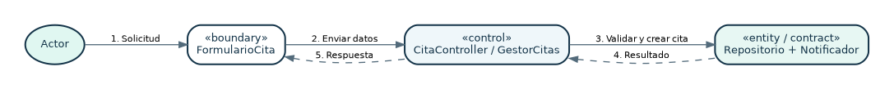

*Figura. Comunicación del caso CU06: Agendar una cita médica. Elaboración propia para SaludCita.*

##### CU07 · Consultar agenda de citas

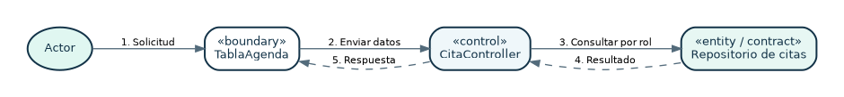

*Figura. Comunicación del caso CU07: Consultar agenda de citas. Elaboración propia para SaludCita.*

##### CU08 · Gestionar estado de una cita

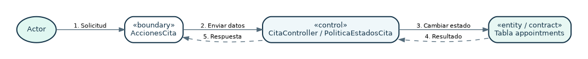

*Figura. Comunicación del caso CU08: Gestionar estado de una cita. Elaboración propia para SaludCita.*

#### CICLO #2

##### CU09 · Registrar consulta e historia clínica

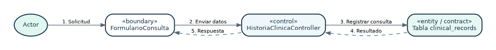

*Figura. Comunicación del caso CU09: Registrar consulta e historia clínica. Elaboración propia para SaludCita.*

##### CU10 · Consultar historia clínica

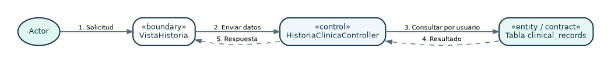

*Figura. Comunicación del caso CU10: Consultar historia clínica. Elaboración propia para SaludCita.*

##### CU11 · Emitir factura de consulta

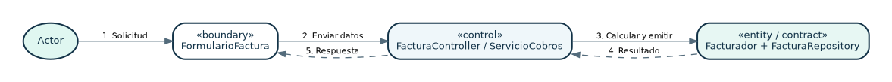

*Figura. Comunicación del caso CU11: Emitir factura de consulta. Elaboración propia para SaludCita.*

##### CU12 · Registrar pago de factura

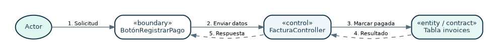

*Figura. Comunicación del caso CU12: Registrar pago de factura. Elaboración propia para SaludCita.*

##### CU13 · Consultar facturas y saldos

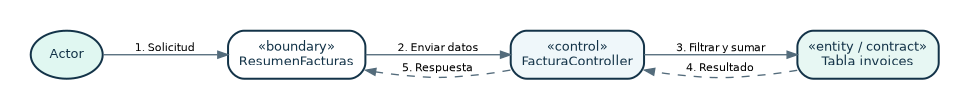

*Figura. Comunicación del caso CU13: Consultar facturas y saldos. Elaboración propia para SaludCita.*

##### CU14 · Consultar y marcar notificaciones

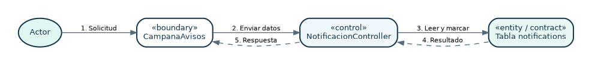

*Figura. Comunicación del caso CU14: Consultar y marcar notificaciones. Elaboración propia para SaludCita.*

##### CU15 · Registrar paciente desde recepción

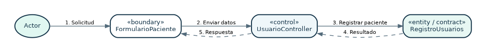

*Figura. Comunicación del caso CU15: Registrar paciente desde recepción. Elaboración propia para SaludCita.*

##### CU16 · Consultar panel de indicadores

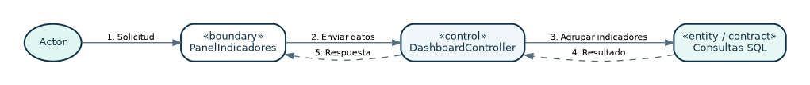

*Figura. Comunicación del caso CU16: Consultar panel de indicadores. Elaboración propia para SaludCita.*

## 3.3. ANALIZAR UNA CLASE

En análisis se identifican objetos que representan al dominio y el comportamiento de cada CU. La tabla siguiente separa las clases PHP existentes de conceptos modelados mediante tablas y controladores. Se evita afirmar que un concepto de análisis ya está implementado como una clase PHP independiente cuando no lo está.

### DIAGRAMA GENERAL DE CLASES Y CONTRATOS SOLID

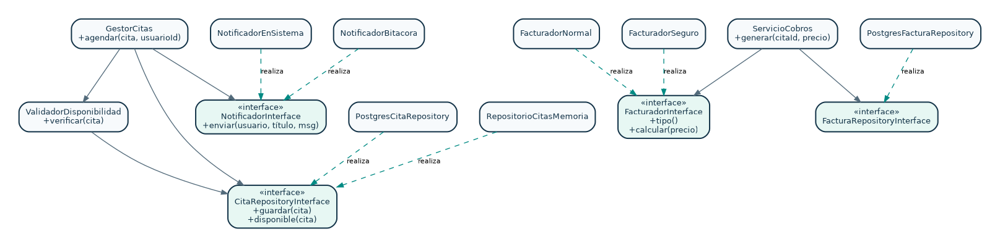

*Figura. Colaboración de servicios, interfaces e infraestructura (modelo implementado). Elaboración propia para SaludCita.*

| Clase o entidad | Atributos principales | Métodos y operaciones | Estado en el proyecto |
| --- | --- | --- | --- |
| Cita | pacienteId, medicoId, fechaHora, motivo, creadoPor | constructor; acceso a propiedades | Clase PHP `app/Models/Cita.php` |
| GestorCitas | repositorio, notificador, validador | agendar(cita,usuarioPacienteId) | Clase PHP de servicio |
| ValidadorDisponibilidad | repositorio | verificar(cita) | Clase PHP de servicio |
| PoliticaEstadosCita | reglas de transición (política) | validar(actual,nuevo,rol,fecha) | Clase PHP de servicio |
| FacturadorNormal / FacturadorSeguro | estrategia de cálculo | tipo(), calcular(precio) | Clases PHP implementan contrato |
| ServicioCobros | facturador, repositorioFactura | generar(citaId,precio) | Clase PHP de servicio |
| NotificadorEnSistema | conexión a PostgreSQL | enviar(usuario,título,mensaje) | Clase PHP implementa contrato |
| Paciente, Médico, Especialidad | id, usuario_id, atributos de perfil | guardar / consultar (conceptual) | Entidades SQL + controladores; no todas son clases de dominio PHP separadas |
| HistoriaClinica, Factura, Notificacion | id, cita_id, contenido, estado | registrar / consultar / pagar (conceptual) | Entidades SQL + controladores; no todas son clases de dominio PHP separadas |

### CICLO #1 — CLASES DE ANÁLISIS POR CASO

#### CU01 — Iniciar sesión

| Tipo UML | Objeto / componente | Responsabilidad |
| --- | --- | --- |
| «boundary» | FormularioLogin | Recibir las entradas, mostrar errores y resultados sin decidir autorizaciones. |
| «control» | AuthController | Validar flujo, permisos, reglas y coordinar persistencia. |
| «entity» | Usuario PostgreSQL | Conservar o recuperar datos según contrato/tabla. |

**Operación central:** Validar credenciales y rol. **Restricción:** permisos y reglas se verifican en PHP, no solamente ocultando botones de la interfaz.

#### CU02 — Registrar cuenta de paciente

| Tipo UML | Objeto / componente | Responsabilidad |
| --- | --- | --- |
| «boundary» | FormularioRegistro | Recibir las entradas, mostrar errores y resultados sin decidir autorizaciones. |
| «control» | AuthController | Validar flujo, permisos, reglas y coordinar persistencia. |
| «entity» | RegistroUsuarios | Conservar o recuperar datos según contrato/tabla. |

**Operación central:** Crear paciente. **Restricción:** permisos y reglas se verifican en PHP, no solamente ocultando botones de la interfaz.

#### CU03 — Administrar usuarios y roles

| Tipo UML | Objeto / componente | Responsabilidad |
| --- | --- | --- |
| «boundary» | VistaUsuarios | Recibir las entradas, mostrar errores y resultados sin decidir autorizaciones. |
| «control» | UsuarioController | Validar flujo, permisos, reglas y coordinar persistencia. |
| «entity» | Tabla users | Conservar o recuperar datos según contrato/tabla. |

**Operación central:** Asignar rol. **Restricción:** permisos y reglas se verifican en PHP, no solamente ocultando botones de la interfaz.

#### CU04 — Gestionar médicos y especialidades

| Tipo UML | Objeto / componente | Responsabilidad |
| --- | --- | --- |
| «boundary» | VistaMedicos | Recibir las entradas, mostrar errores y resultados sin decidir autorizaciones. |
| «control» | CatalogoController | Validar flujo, permisos, reglas y coordinar persistencia. |
| «entity» | Tablas doctors / specialties | Conservar o recuperar datos según contrato/tabla. |

**Operación central:** Guardar médico. **Restricción:** permisos y reglas se verifican en PHP, no solamente ocultando botones de la interfaz.

#### CU05 — Configurar horarios de médicos

| Tipo UML | Objeto / componente | Responsabilidad |
| --- | --- | --- |
| «boundary» | VistaHorarios | Recibir las entradas, mostrar errores y resultados sin decidir autorizaciones. |
| «control» | CatalogoController | Validar flujo, permisos, reglas y coordinar persistencia. |
| «entity» | Tabla schedules | Conservar o recuperar datos según contrato/tabla. |

**Operación central:** Registrar horario. **Restricción:** permisos y reglas se verifican en PHP, no solamente ocultando botones de la interfaz.

#### CU06 — Agendar una cita médica

| Tipo UML | Objeto / componente | Responsabilidad |
| --- | --- | --- |
| «boundary» | FormularioCita | Recibir las entradas, mostrar errores y resultados sin decidir autorizaciones. |
| «control» | CitaController / GestorCitas | Validar flujo, permisos, reglas y coordinar persistencia. |
| «entity» | Repositorio + Notificador | Conservar o recuperar datos según contrato/tabla. |

**Operación central:** Validar y crear cita. **Restricción:** permisos y reglas se verifican en PHP, no solamente ocultando botones de la interfaz.

#### CU07 — Consultar agenda de citas

| Tipo UML | Objeto / componente | Responsabilidad |
| --- | --- | --- |
| «boundary» | TablaAgenda | Recibir las entradas, mostrar errores y resultados sin decidir autorizaciones. |
| «control» | CitaController | Validar flujo, permisos, reglas y coordinar persistencia. |
| «entity» | Repositorio de citas | Conservar o recuperar datos según contrato/tabla. |

**Operación central:** Consultar por rol. **Restricción:** permisos y reglas se verifican en PHP, no solamente ocultando botones de la interfaz.

#### CU08 — Gestionar estado de una cita

| Tipo UML | Objeto / componente | Responsabilidad |
| --- | --- | --- |
| «boundary» | AccionesCita | Recibir las entradas, mostrar errores y resultados sin decidir autorizaciones. |
| «control» | CitaController / PoliticaEstadosCita | Validar flujo, permisos, reglas y coordinar persistencia. |
| «entity» | Tabla appointments | Conservar o recuperar datos según contrato/tabla. |

**Operación central:** Cambiar estado. **Restricción:** permisos y reglas se verifican en PHP, no solamente ocultando botones de la interfaz.

### CICLO #2 — CLASES DE ANÁLISIS POR CASO

#### CU09 — Registrar consulta e historia clínica

| Tipo UML | Objeto / componente | Responsabilidad |
| --- | --- | --- |
| «boundary» | FormularioConsulta | Recibir las entradas, mostrar errores y resultados sin decidir autorizaciones. |
| «control» | HistoriaClinicaController | Validar flujo, permisos, reglas y coordinar persistencia. |
| «entity» | Tabla clinical_records | Conservar o recuperar datos según contrato/tabla. |

**Operación central:** Registrar consulta. **Restricción:** permisos y reglas se verifican en PHP, no solamente ocultando botones de la interfaz.

#### CU10 — Consultar historia clínica

| Tipo UML | Objeto / componente | Responsabilidad |
| --- | --- | --- |
| «boundary» | VistaHistoria | Recibir las entradas, mostrar errores y resultados sin decidir autorizaciones. |
| «control» | HistoriaClinicaController | Validar flujo, permisos, reglas y coordinar persistencia. |
| «entity» | Tabla clinical_records | Conservar o recuperar datos según contrato/tabla. |

**Operación central:** Consultar por usuario. **Restricción:** permisos y reglas se verifican en PHP, no solamente ocultando botones de la interfaz.

#### CU11 — Emitir factura de consulta

| Tipo UML | Objeto / componente | Responsabilidad |
| --- | --- | --- |
| «boundary» | FormularioFactura | Recibir las entradas, mostrar errores y resultados sin decidir autorizaciones. |
| «control» | FacturaController / ServicioCobros | Validar flujo, permisos, reglas y coordinar persistencia. |
| «entity» | Facturador + FacturaRepository | Conservar o recuperar datos según contrato/tabla. |

**Operación central:** Calcular y emitir. **Restricción:** permisos y reglas se verifican en PHP, no solamente ocultando botones de la interfaz.

#### CU12 — Registrar pago de factura

| Tipo UML | Objeto / componente | Responsabilidad |
| --- | --- | --- |
| «boundary» | BotónRegistrarPago | Recibir las entradas, mostrar errores y resultados sin decidir autorizaciones. |
| «control» | FacturaController | Validar flujo, permisos, reglas y coordinar persistencia. |
| «entity» | Tabla invoices | Conservar o recuperar datos según contrato/tabla. |

**Operación central:** Marcar pagada. **Restricción:** permisos y reglas se verifican en PHP, no solamente ocultando botones de la interfaz.

#### CU13 — Consultar facturas y saldos

| Tipo UML | Objeto / componente | Responsabilidad |
| --- | --- | --- |
| «boundary» | ResumenFacturas | Recibir las entradas, mostrar errores y resultados sin decidir autorizaciones. |
| «control» | FacturaController | Validar flujo, permisos, reglas y coordinar persistencia. |
| «entity» | Tabla invoices | Conservar o recuperar datos según contrato/tabla. |

**Operación central:** Filtrar y sumar. **Restricción:** permisos y reglas se verifican en PHP, no solamente ocultando botones de la interfaz.

#### CU14 — Consultar y marcar notificaciones

| Tipo UML | Objeto / componente | Responsabilidad |
| --- | --- | --- |
| «boundary» | CampanaAvisos | Recibir las entradas, mostrar errores y resultados sin decidir autorizaciones. |
| «control» | NotificacionController | Validar flujo, permisos, reglas y coordinar persistencia. |
| «entity» | Tabla notifications | Conservar o recuperar datos según contrato/tabla. |

**Operación central:** Leer y marcar. **Restricción:** permisos y reglas se verifican en PHP, no solamente ocultando botones de la interfaz.

#### CU15 — Registrar paciente desde recepción

| Tipo UML | Objeto / componente | Responsabilidad |
| --- | --- | --- |
| «boundary» | FormularioPaciente | Recibir las entradas, mostrar errores y resultados sin decidir autorizaciones. |
| «control» | UsuarioController | Validar flujo, permisos, reglas y coordinar persistencia. |
| «entity» | RegistroUsuarios | Conservar o recuperar datos según contrato/tabla. |

**Operación central:** Registrar paciente. **Restricción:** permisos y reglas se verifican en PHP, no solamente ocultando botones de la interfaz.

#### CU16 — Consultar panel de indicadores

| Tipo UML | Objeto / componente | Responsabilidad |
| --- | --- | --- |
| «boundary» | PanelIndicadores | Recibir las entradas, mostrar errores y resultados sin decidir autorizaciones. |
| «control» | DashboardController | Validar flujo, permisos, reglas y coordinar persistencia. |
| «entity» | Consultas SQL | Conservar o recuperar datos según contrato/tabla. |

**Operación central:** Agrupar indicadores. **Restricción:** permisos y reglas se verifican en PHP, no solamente ocultando botones de la interfaz.

## 3.4. ANALIZAR UN PAQUETE

*Figura. Dependencias entre paquetes para evaluación del análisis. Elaboración propia para SaludCita.*

| Dependencia lógica | Justificación |
| --- | --- |
| P2 → P1 | La creación de médicos, especialidades y pacientes exige saber quién tiene permisos. |
| P3 → P2 | Agendar necesita médico, paciente y horarios existentes. |
| P3 → P1 | Las reservas y transiciones consultan identidad y rol. |
| P3 → P6 | Confirmación y cambios generan avisos para el paciente. |
| P4 → P3 | La atención clínica solo puede vincularse a una cita válida. |
| P4 → P1 | El registro clínico comprueba identidad y médico asignado. |
| P5 → P3 | Una factura pertenece a una cita confirmada o completada. |
| P5 → P1 | La emisión y el pago requieren roles autorizados. |
| P5 → P6 | La emisión puede generar un mensaje al paciente. |
| P6 → P1 | Los mensajes están asociados al usuario destinatario. |

## 3.5. TRAZABILIDAD ENTRE DOCUMENTACIÓN Y SOFTWARE

| Artefacto | Ruta en el proyecto | Uso |
| --- | --- | --- |
| Código backend | `app/Http/Controllers/`, `app/Services/`, `app/Infrastructure/` | Ejecuta operaciones de los casos de uso |
| Interfaces SOLID | `app/Contracts/` | Extensibilidad y sustitución de adaptadores |
| Rutas REST | `routes/api.php` | Mapea solicitud a controlador |
| Modelos y persistencia | `app/Models/`, `database/schema.sql` | Entidades y restricciones de datos |
| Interfaz y prototipos | `resources/views/app.html`, `public/assets/` | Implementación de formularios y paneles |
| Pruebas | `tests/run.php` | Comprueba reglas aisladas y ruta/controlador |
| Despliegue | `docker-compose.yml`, `Dockerfile` | PHP/Apache y PostgreSQL locales |

## 3.6. LIMITACIONES Y CRITERIOS DE VALIDACIÓN

La documentación de análisis está completa a nivel académico para el alcance señalado, pero **no constituye validación formal por el docente ni certificación del despliegue completo**. Las pruebas automatizadas disponibles verifican principalmente lógica de negocio y rutas; las pruebas de integración, permisos en todos los escenarios, usabilidad y seguridad con la base PostgreSQL en ejecución deben efectuarse en Docker y documentarse con evidencias.

El repositorio es un prototipo: las facturas no son fiscales y el descuento de seguro es ficticio. No deben utilizarse datos de pacientes reales. Los diagramas son especificaciones de análisis elaboradas para el caso de estudio; los nombres conceptuales pueden diferir de los archivos PHP cuando no existe un objeto de dominio físico.

\newpage

# ANEXO A. MATRIZ DE PERMISOS POR ACTOR

| Caso | Paciente | Recepción | Médico | Administrador |
| --- | --- | --- | --- | --- |
| CU01 | Sí | Sí | Sí | Sí |
| CU02 | Sí | No | No | No |
| CU03 | No | No | No | Sí |
| CU04 | No | No | No | Sí |
| CU05 | No | No | No | Sí |
| CU06 | Sí | Sí | No | Sí |
| CU07 | Sí | Sí | Sí | Sí |
| CU08 | Sí | Sí | Sí | Sí |
| CU09 | No | No | Sí | No |
| CU10 | Sí | No | Sí | No |
| CU11 | No | Sí | No | Sí |
| CU12 | No | Sí | No | Sí |
| CU13 | Sí | Sí | No | Sí |
| CU14 | Sí | Sí | Sí | Sí |
| CU15 | No | Sí | No | Sí |
| CU16 | Sí | Sí | Sí | Sí |

# ANEXO B. GUION DE PRUEBAS Y PRESENTACIÓN

1. Iniciar sesión con un usuario de cada rol y observar que las secciones visibles difieren.
2. Ingresar como Administrador: registrar una especialidad y un médico, y asignar horario.
3. Ingresar como Paciente: reservar una cita válida, luego intentar reservar el mismo turno para comprobar rechazo.
4. Ingresar como Recepcionista: confirmar la cita. Verificar que el paciente reciba aviso interno.
5. Ingresar como Médico: consultar su agenda y registrar consulta de una cita confirmada cuyo horario haya llegado.
6. Ingresar como Recepcionista: emitir factura normal y registrar pago; mostrar cambio de estado.
7. Volver a Paciente: comprobar historia, factura y notificaciones.
8. Demostrar SOLID: mostrar FacturadorInterface con las clases Normal y Seguro; luego repositorio y notificador mediante sus contratos.
9. Mostrar los diagramas en secuencia: actividad → casos de uso → comunicación → clases → paquetes.

**Instalación de demostración:** ejecutar `docker compose up -d --build`; después `docker compose exec app php scripts/install.php`; abrir `http://localhost:8080`. Para ejecutarlo, Docker Desktop debe estar activo. Comprobar versiones y que PostgreSQL haya iniciado correctamente antes de la exposición.

# REFERENCIA DE FORMATO

La organización de secciones (Perfil, Marco teórico, Modelo de negocio, Captura de requisitos, Análisis) fue inspirada en el documento universitario de referencia proporcionado por el usuario (“SEGUNDO PARCIAL SI1_PRESENTACION #2”), cuyo proyecto temático es asignación de horarios académicos. Las descripciones, tablas y diagramas de este documento fueron redactados específicamente para SaludCita. La estructura técnica se contrastó con el código real de SaludCita versión 2.

## ANEXO V4 — CASO DE USO CU05: ELIMINACIÓN DE HORARIOS

Consultar el análisis del controlador, servicio, flujo alternativo 409, secuencia y rutas individuales en `docs/ACTUALIZACION_V4_RUTAS_HORARIOS.md`. La ruta de usuario `/administrador/horarios` corresponde al backend autenticado `DELETE /api/schedules/{id}`.
