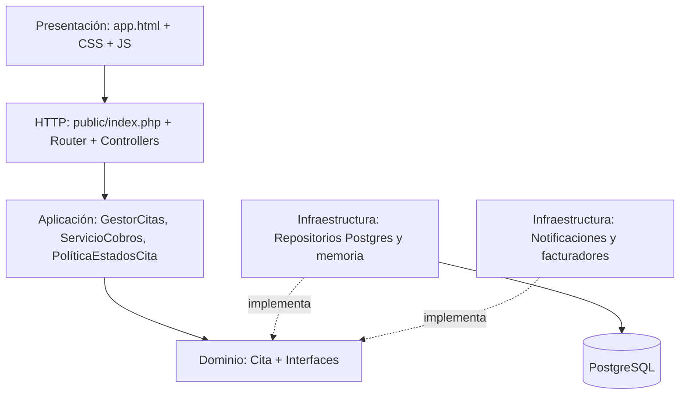

# Guía de estructura, alcance y entregables para Ingeniería de Requisitos

## 1. Comprobación de las imágenes de la pizarra

En las fotografías se distinguen: **FT Requisitos**, **FT Análisis**, **FT Diseño** (diseño de arquitectura física: despliegue; diseño lógico: paquetes en capas), diseño de al menos un caso de uso y **diagrama de secuencia de cada caso de uso elegido**, además de avance de implementación. La tercera pizarra menciona el caso de estudio **gestionar historias clínicas médicas** y un ciclo de requisitos, análisis, diseño, implementación y pruebas, con una elección tecnológica que incluye PHP y PostgreSQL.

Las capturas del otro semestre son un ejemplo de separación de `Controllers`, `Models`, `Services`, `routes`, `database`, `resources` y `public`; su temática es cerámica, **no se traslada al dominio médico**. Se utiliza como inspiración estructural, no se copia su backend ni se exige su framework.

## 2. Entregables organizados por parcial y ciclos

| Entregable | Estado en SaludCita | Archivo / módulo |
|---|---|---|
| Objetivos, alcance, actores, RF, RNF | Documentado | `docs/REQUISITOS_Y_UML.md` |
| Reglas de negocio | Documentado y aplicado | docs, servicios, PostgreSQL |
| Casos de uso | Diagrama global; CU-01, CU-02 y CU-03 | `docs/REQUISITOS_Y_UML.md` |
| Diagrama de clases | Interfaces, servicios, repositorios | docs; `app/Contracts` |
| Diagrama de paquetes lógico | Separación por capas | docs, `app/` |
| Diagrama de despliegue físico | Navegador, contenedor PHP, contenedor PostgreSQL | docs, Dockerfile y compose |
| Diagramas de secuencia | Agendar, facturar, registrar consulta | docs |
| Diagrama de comunicación | Registrar cita | docs |
| Implementación y pruebas | Demo local con roles + pruebas unitarias | `public/`, `app/`, `tests/` |

**Ciclo 1:** autenticación, gestión de pacientes/médicos, agenda, disponibilidad y cancelación.

**Ciclo 2:** historia clínica, facturación, notificaciones, arquitectura SOLID, diagramas y pruebas.

La correspondencia exacta de las numeraciones de la pizarra (1–5 de requisitos y 1–4 de análisis) debe revisarse con el profesor si se trata de rúbrica numerada, ya que en la foto no se leen títulos de todos esos subapartados.

## 3. Capas y responsabilidades

| Clase | Una razón para cambiar |
|---|---|
| `AuthController` | Cambia el protocolo del login o registro web |
| `CitaController` | Cambia la forma HTTP de crear o actualizar citas |
| `GestorCitas` | Cambia la orquestación del caso de uso de agendar |
| `ValidadorDisponibilidad` | Cambian las reglas de horarios disponibles |
| `PoliticaEstadosCita` | Cambian las transiciones de estado |
| `ServicioCobros` | Cambia el proceso de cobro |
| `FacturadorNormal` | Cambia el cálculo de tarifa normal |
| `FacturadorSeguro` | Cambia el cálculo de descuento de demostración |
| `NotificadorEnSistema` | Cambia la forma de guardar avisos en el sistema |
| `PostgresCitaRepository` | Cambia la persistencia PostgreSQL de citas |

> **OCP realista:** los servicios de aplicación no cambian al añadir una nueva implementación. Sí será necesario **registrar** la nueva estrategia en la configuración/composición y ofrecerla en UI si el usuario debe elegirla.

## 4. Casos de uso principales para la exposición

**CU-01 Agendar cita**: actor Paciente; precondición cuenta autenticada; flujo elegir médico, fecha y motivo → comprobar horario y doble reserva → guardar cita pendiente → generar notificación. Alternativa: horario ocupado, mostrar error sin guardar.

**CU-02 Emitir factura**: actor Recepcionista; precondición cita confirmada/completada y sin factura previa; elegir normal/seguro → estrategia calcula → repositorio persiste → notificación. Alternativa: duplicado o estado no permitido.

**CU-03 Registrar historia clínica**: actor Médico; precondición cita propia ya comenzada y confirmada/completada; anotar síntomas/diagnóstico/tratamiento → guardar registro único → completar cita → notificar. Alternativa: acceso denegado, cita futura o historial duplicado.

**CU-04 Crear cuenta paciente**: actor Visitante; precondición no autenticado; ingresar nombre, correo, documento, contraseña → validar → registrar usuario con rol **paciente** y su ficha. No existe registro público como médico ni administrador.

## 5. Diseño físico local vs nube

En la versión entregada, `http://localhost:8080` se abre solo en la computadora donde Docker corre; en Docker se comunica con PostgreSQL dentro de su red. Vercel/Railway son posibles opciones **futuras** si el docente exige un enlace público. La pizarra no demuestra tal obligación.

## 6. Limitaciones conocidas / pruebas de aceptación pendientes

- El proyecto sigue siendo una demo académica; falta un control de seguridad y privacidad adecuado para datos reales.
- Facturación y pagos son simulados; los montos no son comprobantes tributarios oficiales.
- Las notificaciones son internas; no hay email ni WhatsApp reales.
- Se validó la sintaxis del backend y el frontend y se ejecutaron pruebas unitarias; debe probarse el flujo **completo** contra Docker/PostgreSQL en el equipo del estudiante.
- Antes de la entrega, comprobar por rol los pasos de la sección **Demostración** del README y tomar capturas de cada caso de uso ejecutado.
