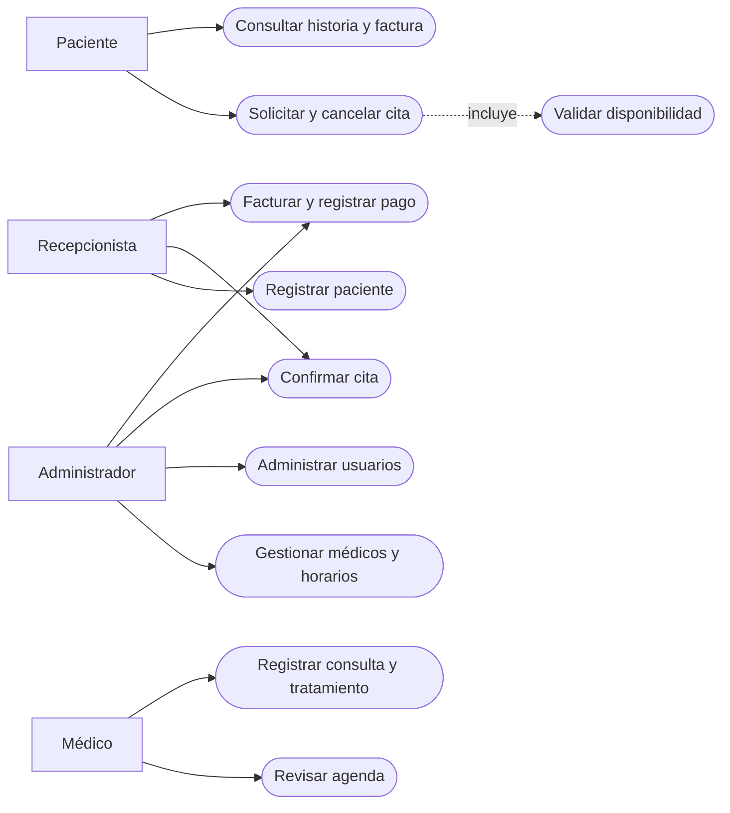
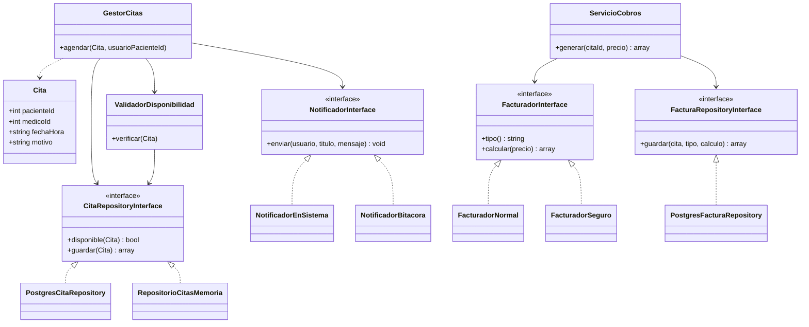
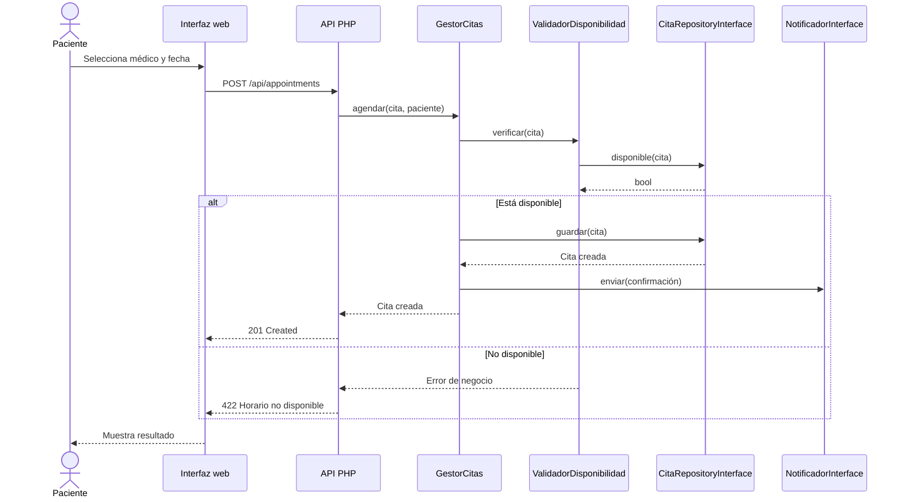
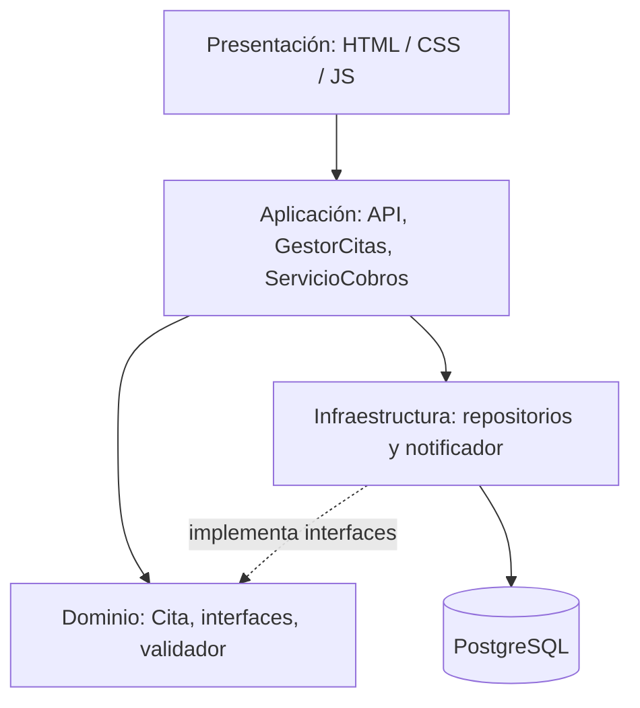
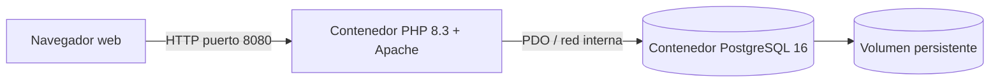
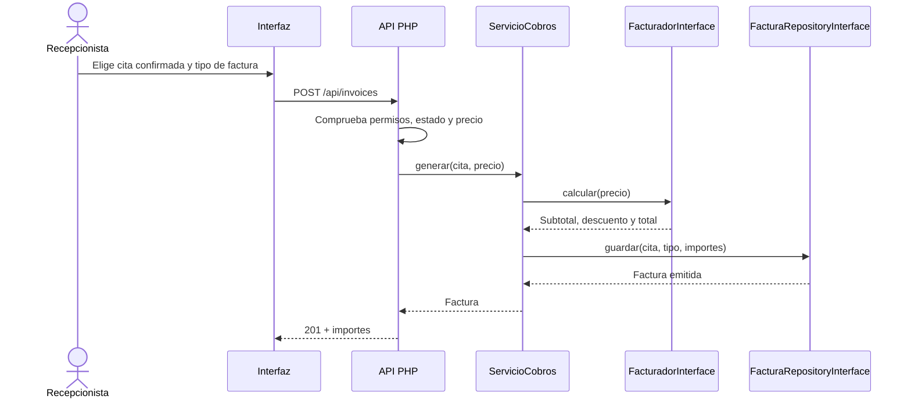
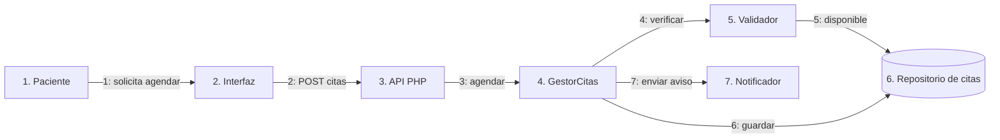
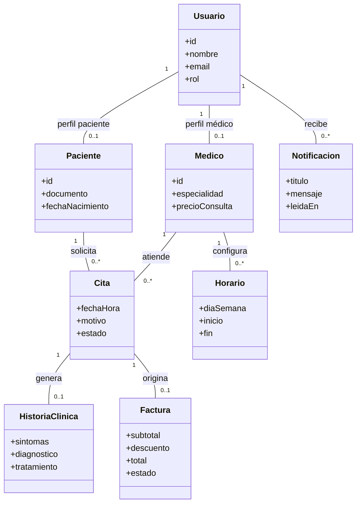

# Análisis y diseño — SaludCita

**Asignatura:** Ingeniería de Requisitos y Modelado. **Proyecto académico:** gestión de citas médicas.

## 1. Objetivo

Administrar citas médicas en una clínica con autenticación por cuatro roles, control de disponibilidad,
registro de atención, facturación sencilla y notificaciones internas. El diseño utiliza interfaces para
poder extender facturación, notificaciones y persistencia sin modificar el gestor de citas.

## 2. Actores y permisos

- **Paciente:** ver agenda propia, solicitar y cancelar citas, consultar médicos, historias clínicas propias,
  facturas propias y avisos.
- **Recepcionista:** alta de pacientes, reserva/confirmación/cancelación de citas, emisión de facturas y registro de pagos.
- **Médico:** ver agenda propia, completar una cita y registrar síntomas, diagnóstico y tratamiento de sus pacientes.
- **Administrador:** altas de profesionales, recepción y administradores; configuración de especialidades
  y horarios, gestión global de citas y facturación. No accede automáticamente a historias clínicas.

## 3. Requisitos funcionales

| ID | Requisito | Actor principal |
|---|---|---|
| RF-01 | Iniciar sesión según rol | Todos |
| RF-02 | Registrar pacientes | Recepción, administrador |
| RF-03 | Dar de alta médicos y especialidades | Administrador |
| RF-04 | Configurar horario semanal de médicos | Administrador |
| RF-05 | Agendar cita en intervalos de 30 minutos y verificar disponibilidad | Paciente, recepción, administrador |
| RF-06 | Consultar, confirmar y cancelar citas según permisos | Todos, según rol |
| RF-07 | Registrar consulta y tratamiento, con cita asociada | Médico |
| RF-08 | Generar factura normal o con descuento de seguro de demostración | Recepción, administrador |
| RF-09 | Registrar pago de factura | Recepción, administrador |
| RF-10 | Leer notificaciones internas | Cada usuario |
| RF-11 | Gestionar usuarios administrativos | Administrador |

## 4. Requisitos no funcionales

- **RNF-01 Seguridad:** contraseñas con `password_hash`; sesión HTTP-only, token CSRF, consultas preparadas y control de rol en cada endpoint.
- **RNF-02 Integridad:** índices únicos parciales impiden dobles reservas activas por médico y por paciente.
- **RNF-03 Modularidad:** aplicar SRP, OCP y DIP a orquestación, notificación, facturación y persistencia.
- **RNF-04 Usabilidad:** panel responsive para los cuatro roles, validaciones visibles.
- **RNF-05 Mantenibilidad:** capas y clases separadas en carpetas, pruebas unitarias sin conexión a BD.

## 5. Reglas de negocio

- La fecha de una reserva debe ser futura y el minuto debe ser `00` o `30`.
- El turno tiene **30 minutos** y debe caber completamente en un horario semanal habilitado.
- No puede haber dos citas no canceladas para el mismo médico y turno, ni dos citas del mismo paciente a la misma hora.
- Estados permitidos: `pendiente` → `confirmada` → `completada`; `pendiente` o `confirmada` → `cancelada`.
- Solo las citas confirmadas o completadas se pueden facturar; máximo una factura por cita.
- Solo el médico asignado puede registrar una consulta de su cita pasada/actual; máximo un registro por cita.
- La tarifa de `seguro` (20 %) es ilustrativa, no hay integración con aseguradora ni emisión fiscal.

## 6. Diagrama de casos de uso (representación Mermaid)



## 7. Diagrama de clases — OCP y SRP



## 8. Diagrama de secuencia — CU-01 Agendar cita



## 9. Diagrama de paquetes (diseño lógico en capas)



## 10. Diagrama de despliegue (diseño físico)



## 11. Extensión OCP

**Cambio en facturación:** escribir `FacturadorConvenio implements FacturadorInterface` y registrarlo en la configuración / composición de dependencias, sin cambiar `ServicioCobros`.

**Cambio en notificaciones:** escribir `NotificadorEmail implements NotificadorInterface` (requiere servidor SMTP) y usarlo al construir `GestorCitas`, sin tocar su lógica.

**Cambio en base de datos:** implementar `CitaRepositoryInterface` y enlazar el nuevo adaptador en el punto de composición.

La selección de implementaciones se realiza actualmente en la ruta API (composición de objetos). Agregar un tipo seleccionable de factura exige exponerlo en la selección de estrategias de esa capa, **pero no modificar las clases de negocio existentes**.

## 12. Criterios de aceptación

1. Ingresar con los cuatro perfiles de ejemplo.
2. Paciente agenda un turno disponible; se crea una notificación interna.
3. Intentar otra reserva para ese mismo médico/horario devuelve error.
4. Recepcionista confirma la cita y genera factura normal o con descuento.
5. Recepcionista registra pago; paciente ve factura y aviso.
6. Médico consulta su agenda y registra síntomas, diagnóstico y tratamiento solo de citas propias.
7. Paciente ve únicamente su historia clínica y su facturación.
8. El administrador puede crear un médico y sus horarios, sin poder leer historias clínicas.
9. Las pruebas de servicios funcionan sin PostgreSQL gracias al repositorio en memoria.

## 13. Trabajo fuera del alcance del prototipo

No integra SMS, WhatsApp, SMTP real, facturación electrónica del SIN, pagos reales, sistema hospitalario,
recetas firmadas, historia clínica interoperable ni controles legales/compliance completos. No usar datos
médicos reales en el entorno de demostración.

## 14. Diagrama de secuencia — CU-02 Emitir factura



## 15. Diagrama de secuencia — CU-03 Registrar consulta

```mermaid
sequenceDiagram
    actor M as Médico
    participant UI as Interfaz
    participant API as API PHP
    participant DB as PostgreSQL
    M->>UI: Registra síntomas, diagnóstico y tratamiento
    UI->>API: POST /api/records
    API->>DB: Busca cita y médico asignado
    DB-->>API: Datos de cita
    API->>API: Verifica titularidad y fecha
    alt Cita autorizada y ya iniciada
      API->>DB: BEGIN; guarda registro; completa cita; COMMIT
      DB-->>API: Confirmación
      API-->>UI: Registro creado
    else No autorizada
      API-->>UI: Error de acceso / validación
    end
```

## 16. Diagrama de comunicación — CU-01 Registrar cita

Los mismos participantes del diagrama de secuencia se representan por las siguientes relaciones y mensajes numerados:



## 17. Evolución de la estructura — Inspiración del proyecto de referencia

En la segunda versión se separaron las rutas y el enrutador de los controladores, de forma similar a la organización del proyecto de ejemplo Laravel (sin copiar su framework). Las clases de HTTP están ahora en `app/Http/Controllers` y `app/Http/Requests`; las rutas se declaran en `routes/api.php`, la página está en `resources/views`, los contratos permanecen en `app/Contracts`, la lógica de negocio está en `app/Services` y los adaptadores en `app/Infrastructure`.

## 18. RF adicionales de la versión mejorada

| ID | Requisito adicional | Criterio de aceptación |
|---|---|---|
| RF-12 | Registro autónomo de pacientes | Un visitante puede registrar paciente y no puede atribuirse rol médico/administrador |
| RF-13 | Campana de notificaciones | El usuario consulta solo sus mensajes y puede marcar como leído |
| RF-14 | Resumen de estado de pagos | Paciente ve su saldo de facturas emitidas, pagadas y estado «al día» |

En particular, el registro de paciente es independiente del formulario de alta utilizado por recepción. La política de estados de citas se separó en `PoliticaEstadosCita` y el selector de estrategia de factura en `CatalogoFacturadores`, evitando cambios a `ServicioCobros` al introducir un nuevo cálculo.


## 19. Diagrama de clases del dominio (relaciones de datos)

Este diagrama completa el de interfaces y responsabilidades con la estructura relacional del caso de estudio:



**Nota:** estas clases conceptuales representan tablas y relaciones de dominio. La implementación PHP utiliza `App\Models\Cita` como entidad explícita y consultas preparadas con PDO para las demás; no utiliza un ORM Laravel ni presupone que todas las tablas tengan una clase ActiveRecord.
